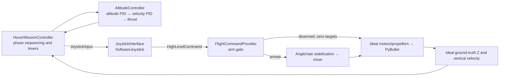

# Altitude hover demo through a software joystick

Status: **Implemented and verified**

[Design menu](index.md) · [Implementation plan](../../plan/0004-altitude-hover-demo.md) · [Internal stabilization](internal-flight-control.md)

## Run and behavior

```bash
uv run examples/hover/main.py
uv run examples/hover/main.py --headless
```

The example entry point is `examples/hover/main.py`. The default uses the existing PyBullet GUI and wall-clock pacing; headless mode runs unpaced without a display. The `bullet-drone --config ...` application entry point runs the core simulation without choosing a hover scenario.

The racer starts level at `(0, 0, 0.015)` m with motors disarmed by default. Override its initial PyBullet-world position with `--initial-position X Y Z` (meters), or pass `initial_position_m` to `run_hover_demo()`. The three-drone VS Code task uses ground-level starts at `(0,0,0.015)`, `(1.5,0.25,0.015)`, and `(3,0.5,0.015)` m. After 0.5 s settling, it arms and takes off to **world Z = 3 m** above the flat ground plane. Hover begins when altitude error stays within 5 cm and vertical speed within 0.1 m/s for one continuous second. It holds altitude for **20 simulated seconds after that transition**, then descends toward world Z = 0, limiting desired descent speed to 0.5 m/s.

Estimated touchdown requires body height at most 2 cm and vertical speed at most 0.05 m/s for 0.5 continuous seconds. The mission then disarms, commands motors off for one second, and finishes. This threshold is specific to the current racer collision geometry and flat-ground scene; it is not a contact sensor. A 45 s simulation budget reports failure if the sequence is incomplete.

All phase timers use simulation time. Leaving the settling/touchdown tolerances resets the corresponding dwell timer. Ctrl+C or any control/physics failure closes the joystick source and physics world. The example returns 0 on completion, 1 on runtime failure/timeout, 2 on argument/configuration errors, and 130 on interruption. Phase diagnostics use Loguru; they are not a telemetry recording format.

## Composition and interfaces



`JoystickInput(mode, rpy, thrust_n, armed)` is immutable, with default Angle mode, zero input, and disarmed state. Its units match `HighLevelCommand`: Angle RPY in radians, Acro body rates in rad/s, and collective thrust in N. This software interface is not a normalized physical joystick or RC-channel adapter.

`JoystickInterface` extends the high-level reset/command/close contract with `set_input(JoystickInput)`. `SoftwareJoystick` resets to zero/disarmed, holds the latest input, and translates it into the current episode's next-step command. It rejects invalid inputs, nonpositive dt, stale episodes/steps, and replay. It owns no external device resources.

`HighLevelCommand` adds strict boolean `armed`, defaulting to **True** for compatibility with existing callers. The provider validates identity and input before the arm gate. When disarmed it bypasses feedback, stabilization, and mixing and returns zero targets for all four motors, regardless of requested thrust/RPY. Arming transitions reset stabilization history. `allocation` is `None` for a disarmed command; otherwise it reports the normal mixer allocation. This is zero-target disarm; ideal motors stop immediately, while future injected motor dynamics may model spin-down.

`HoverMissionController` implements `HighLevelController` and depends on `AltitudeController` and the joystick contract. It reads ideal ground truth, asks the altitude controller for thrust, then sends level Angle input with zero yaw through the joystick. The altitude calculation never sets mission phase or arm state. Mission properties expose phase/completion and immutable `MissionTransition` records. Reset clears timers, history, joystick input, and both altitude PIDs; close is idempotent.

`AltitudeController.thrust(target_altitude_m, altitude_m, vertical_velocity_m_s, dt_s, velocity_limit_m_s=None)` cascades altitude into bounded desired vertical velocity, then into acceleration using the common scalar PID. The immutable `last_output` exposes the last bounded velocity target, acceleration and thrust for [control-chain telemetry](position-control-chain.md), and is cleared on reset. It calculates `mass_kg * (gravity_m_s2 + acceleration_m_s2)` and bounds collective to zero through vehicle capacity. Constructor arguments explicitly provide mass, positive gravity magnitude, total capacity, and position/velocity `PidSettings`; capacity must exceed vehicle weight. Units are world Z up, position m, vertical velocity m/s, acceleration m/s², and thrust N along body +Z. This assumes level flight and supplies no tilt compensation or horizontal position hold.

`run_hover_demo(gui=True, max_duration_s=45)` constructs the fixed ideal-racer composition and returns `HoverDemoResult`, containing the final immutable observation and mission transitions. `examples/hover/main.py` only parses through a Click helper, configures diagnostics, invokes composition, and translates success/failure to an exit code. Example-only composition, mission logic, and the Click helper live in `examples/hover`; reusable altitude/PID/stabilization, joystick, contracts, and physics stay in `src/bullet_drone`. The library never imports the examples package. Direct execution from the repository and `uv run -m examples.hover.main --headless` are supported. No new dependencies, sensor models, or YAML fields are required.

The runner gains optional `stop_when(observation)`, evaluated after each completed step and its optional wall-clock pacing. It stops before another command when the predicate is true; omitted predicates preserve fixed-step behavior. Predicate failures/interruptions follow normal cleanup. The demo stops when the mission completes; reaching the step budget without completion raises `HoverDemoTimeoutError` after runner cleanup.

## Ideal-profile tuning

Defaults use 1 kg mass, downward gravity 9.81 m/s², and 240 Hz physics:

| Loop | Gains | Limits |
| --- | --- | --- |
| Altitude → vertical velocity | P 1.5 s⁻¹; I/D 0 | 1 m/s; landing override 0.5 m/s |
| Vertical velocity → acceleration | P 4 s⁻¹; I 1 s⁻²; D 0 | 3 m/s² acceleration; 1 m/s² integral contribution |
| Attitude → body rates | P `(4,4,4)` s⁻¹ | `(2,2,2)` rad/s |
| Body rates → torque | P `(0.05,0.05,0.05)`; I/D 0 | 0.1 N*m per axis |

The common PID supplies output limiting, bounded integration, and conditional anti-windup at its own output limits. Final thrust capacity clipping does not back-calculate integral state. These gains demonstrate the ideal racer profile and are not universal vehicle tuning.

## Verification and boundaries

The complete headless run starts hover at about 5.179 s, landing at 25.179 s, and disarm at 32.225 s. It finishes at about 33.229 s with body height approximately 0.0135 m and all rotor speeds zero. Maximum height error during the 20 s hover is about 1.74 cm.

Tests verify joystick lifecycle/identity/input translation, command validation before disarm, motor gating and rearming reset, altitude direction/weight compensation/capacity/mass scaling, interrupted dwell periods, mission reset, full flight altitude/speed/timing, timeout and interruption cleanup, stop predicates, and entry-point import/help/exit behavior. Existing physics/stabilization/CLI tests remain applicable.

Horizontal position hold, manual device input, noisy sensors, real motor lag, Betaflight and ADRC remain future work. The example supports [independent Godot rendering](godot-rendering.md) through `--renderer godot`, with DIRECT physics and wall-time pacing.


## Example package boundary

Hover-only code is in `examples/hover`: `main.py`, `demo_cli.py`, `hover_demo.py`, `hover_mission.py`. Run the altitude demo directly or with `uv run -m examples.hover.main --headless`. Import its helper as `examples.hover.hover_demo.run_hover_demo` and mission types from `examples.hover.hover_mission`.

The core package contains reusable simulation, configuration, control interfaces, controllers, mixer, actuator/propeller models, and joystick translation. It never imports examples, and examples are not part of the installed library. `FlightSettings`/`flight.mode` were removed from core configuration; older YAML must remove the `flight` section and select a scenario via the example entry point. The example owns its own Click parsing helper.
