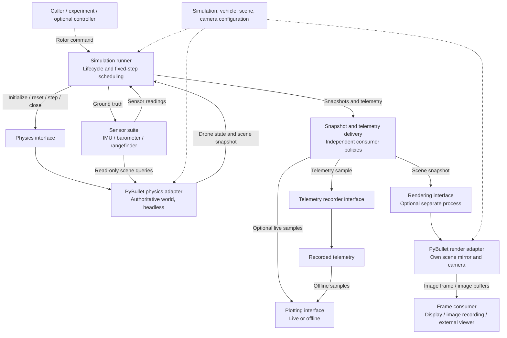

# Quadcopter simulator: initial architecture

Status: **Draft for review**  
Target version: **0.1.0**  
Document revision: **1**  
Date: **2026-10-13**

[Design menu](index.md) · [Versioned requirements](requirements/v0.1.0/index.md) · [Glossary](../../CONTEXT.md)

## 1. Project goal

Design a reusable Python package for simulating a quadcopter with PyBullet. The package should support headless experiments, visual observation, and recording and plotting simulation results. Project and dependency management will use uv when implementation begins.

The central architectural goal is to separate physical evolution from visual observation. Physics owns the authoritative world and simulation clock. Rendering receives snapshots and constructs camera views without controlling or modifying physics. Logging and plotting consume telemetry through independent interfaces. A separate sensors package converts ground truth into noisy measurements; the environment groups ground truth and sensor readings in a `DroneObservation` as described in the [sensor design](sensors.md).

The first version targets one quadcopter in a configured scene, fixed-step simulation, direct rotor commands, camera rendering, telemetry recording, and plotting. Flight controllers may be supplied by callers through the command interface. Built-in autopilots, hardware connections, ROS integration, multiple drones, and advanced aerodynamic models are outside the initial scope.

This document describes the intended overall design. The [first simulation entry-point milestone](simulation-entry-point.md) is implemented with gravity-only physics, GUI/headless modes, and immutable observations. Rotor dynamics, sensor models, independent rendering, and telemetry consumers remain future work before the complete 0.1.0 scope.

## 2. Design principles

| SOLID principle | Application to this project |
| --- | --- |
| Single responsibility | Physics advances dynamics; rendering creates images; recording persists telemetry; plotting visualizes telemetry; the runner coordinates them. |
| Open/closed | Add physics, renderer, recorder, or plotter adapters through existing contracts without modifying the runner. |
| Liskov substitution | Every physics backend obeys the same units, stepping semantics, lifecycle, and failure contract. Every renderer preserves snapshot identity in its output. |
| Interface segregation | Use separate contracts for physics, rendering, frame delivery, recording, and plotting. A logger does not need camera operations. |
| Dependency inversion | The runner depends on project-owned contracts and data types. PyBullet and plotting libraries remain adapter dependencies. |

Prefer small interfaces with explicit ownership. Do not introduce a general plugin framework until concrete extension needs justify it.

## 3. Architecture block diagram

Solid arrows show commands or data flow. Dashed arrows show configuration.

The diagram describes logical components. Only rendering is initially proposed as a separate process; recording and plotting can be in-process adapters or external consumers. Process topology is not part of the physics contract.

## 4. Component responsibilities and ownership

| Component | Owns | Boundary |
| --- | --- | --- |
| Runner | Episode lifecycle, command sequencing, delivery policy, simulation scheduling | Invokes interfaces; contains no rotor-force calculation or camera implementation. |
| Physics backend | Physics client, body identities, dynamics, authoritative simulation time | Accepts commands and returns observations; exposes no PyBullet handles. |
| Vehicle dynamics within physics | Rotor layout, thrust and reaction torque model, configured limits | Converts rotor commands into forces and torques. |
| Sensor suite | IMU, barometer, rangefinder sampling, bias, noise, and measurement timestamps | Consumes ground truth and read-only scene queries; never changes physical state. |
| Renderer | Render client, scene mirror, camera transforms, image generation | Applies snapshot poses; never advances the authoritative simulation. |
| Frame consumer | Display or persistence of image buffers | Receives frames without needing access to a physics client. |
| Telemetry recorder | Recording format, storage, flush behavior | Persists ordered samples and run metadata. |
| Plotter | Plot definitions and display/export | Consumes live or recorded samples; has no simulation control authority. |

Project-owned contracts and data definitions form the shared boundary. Concrete adapters depend on those contracts; the shared definitions do not import PyBullet, a plotting library, or a process transport.

## 5. Physics model and conventions

The proposed initial model is a rigid quadcopter body with configured mass, inertia, rotor positions, and spin directions. Each rotor generates body-axis thrust proportional to squared rotor speed and a signed reaction torque proportional to squared rotor speed. Physics transforms forces into the required frame and applies them at the configured rotor positions. Rotor response is instantaneous in the first draft; motor lag, aerodynamic drag, wind, and battery effects require later requirements.

Proposed boundary conventions, subject to review:

- SI units: meters, seconds, kilograms, radians, newtons, and newton-meters. Rotor speeds are radians per second.
- Right-handed world frame: Z points up; gravity points along negative Z.
- Right-handed body frame: X forward, Y left, Z up; positive thrust points along body positive Z.
- Pose refers to the body center of mass. Orientation uses a normalized quaternion ordered `(x, y, z, w)` mapping body coordinates to world coordinates.
- Linear and angular velocities are expressed in the world frame. Rotor locations are expressed in the body frame relative to the center of mass.
- Rotor order and spin signs are declared in vehicle configuration; callers must not infer them from an unnamed array order.

The runner requests exactly one configured fixed-duration step per command. Physics computes and holds the rotor forces and torques for that step. Physics owns any internal solver substeps. Real-time pacing is optional runner behavior and never changes the configured step duration.

Repeatability means comparable trajectories for the same configuration, commands, seed, and supported environment within declared numerical tolerances. It does not promise bitwise equality across platforms or PyBullet versions.

## 6. Shared data contracts

These are conceptual records, not implementation code. Published records are immutable values or independent copies with no live backend references.

| Record | Required information |
| --- | --- |
| Simulation configuration | Fixed step duration, gravity, seed, solver settings, vehicle configuration, and scene definition. |
| Vehicle configuration | Mass, inertia, rotor identifiers/order, positions, spin directions, speed limits, thrust and torque coefficients, collision and visual assets. |
| Scene definition | Stable scene identity/revision, asset identities, visual transforms relative to bodies, and initial object poses. |
| Rotor command | Ordered rotor speeds, associated episode identity, and intended next step index. |
| Drone state | Ground truth: episode identity, completed step index, simulation time, pose, world-frame velocities, actual rotor speeds when modeled, and explicitly defined optional physical quantities. No noisy sensor readings. |
| Drone observation | Separate ground-truth drone state and latest typed sensor readings, preserving each reading's own timestamp and validity. |
| Scene snapshot | Contract schema version, episode identity, step index, simulation time, scene identity/revision, and poses of all movable visible objects, including the drone. |
| Camera configuration | Camera identity, attached or tracking mode, mounting/view parameters, projection, dimensions, and requested buffer channels. |
| Image frame | Episode and snapshot identity, simulation time, camera identity, dimensions, pixel format, and returned buffers. Depth and segmentation are optional and have declared encodings and object-ID mappings. |
| Telemetry sample | Episode identity, step index, simulation time, command applied during that step, resulting drone state, and named optional measurements with units. |
| Run metadata | Contract schema version, configuration, seed, package/backend versions, and recording policy. |

A reset produces step zero at simulation time zero and a new episode identity. A successful step advances both step index and time once, then publishes the resulting state. Command values, state values, snapshots, and image frames can therefore be correlated without relying on wall-clock arrival order.

## 7. Interfaces to physics and other components

### Physics interface

| Operation | Input | Output and contract |
| --- | --- | --- |
| Initialize | Simulation configuration | Initial drone state and scene snapshot; allocates the backend's own client and resources. |
| Reset | Initial conditions and optional seed override | New episode, initial state and snapshot; clears previous episode commands. Configuration changes require reinitialization in the initial design. |
| Step | Rotor command for the next step | Resulting state and snapshot after one fixed step. Validate command identity, size, limits, and finite values before advancing. |
| Observe | None | Current state and snapshot without advancing time. |
| Close | None | Releases owned resources; repeated close is harmless. |

Operations are serialized by the owner; the physics interface is not assumed thread-safe. Calls made in an invalid lifecycle state return a defined lifecycle error. Invalid commands do not advance time. A backend failure aborts the episode because partial progress may be unknown; the runner publishes no successful sample for that failed step and requires reset or reinitialization before continuing.

### Rendering interface

| Operation | Input | Output and contract |
| --- | --- | --- |
| Initialize scene | Scene definition and camera configuration | Loads visual assets into the renderer's own world. |
| Render snapshot | Scene snapshot | An image frame for that snapshot, or a defined render failure. |
| Configure camera | Camera configuration | Updates observation parameters without changing physics. |
| Close | None | Releases owned rendering resources. |

For an attached camera, the renderer combines drone pose with a fixed body-to-camera transform. For a tracking camera, it derives the viewpoint from the configured tracking rule. The term “hanging camera” is interpreted here as an attached camera mounted beneath the drone; a physically swinging camera would need an additional dynamics model.

The renderer checks scene revision and episode identity before accepting a snapshot. It loads the matching scene before rendering a new revision, discards stale snapshots, and rebuilds or clears episode-specific state after reset.

### Telemetry recorder interface

The recorder opens a run with metadata, appends ordered telemetry samples, flushes buffered data, and closes the run. Recording is independent of rendering. A recording failure is reported explicitly; a run must never claim complete telemetry when samples were lost.

### Plotting interface

The plotter accepts run metadata and telemetry samples, or reads a recorded run. The initial plot set is position, orientation, velocities, and rotor speeds against simulation time. Plot refresh rate is independent of physics step rate. Live plots may skip updates; offline plots use the recorded samples.

### Frame delivery interface

A frame consumer accepts image frames and handles display or image recording. Across a process boundary, a frame contains serialized buffers or a shared-memory descriptor with explicit ownership and release rules. No raw pointers or backend client identifiers cross the boundary. The transport mechanism remains an open decision.

## 8. Rendering and process separation

Two observation paths are supported by the design:

1. **State-driven camera rendering:** a renderer receives the drone/scene snapshot, updates its scene mirror, places an attached or tracking camera, and creates an image.
2. **Buffer consumption in another process:** a frame consumer receives the rendered PyBullet image buffers and displays or records them. The image is still created by a renderer that owns a render client.

These paths can be combined: a separate render process consumes snapshots, generates buffers, and delivers them to a viewer. They do not require sharing the authoritative physics world between processes.

PyBullet documents a headless `DIRECT` connection and camera image generation with its software renderer. Its built-in `GUI` connection places the GUI in the same process. The separate-process design therefore uses an explicitly owned scene mirror rather than assuming the built-in GUI detaches from the physics process. See the [official PyBullet quickstart guide](https://github.com/bulletphysics/bullet3/blob/master/docs/pybullet_quickstart_guide/PyBulletQuickstartGuide.md.html).

The first entry-point milestone also supports PyBullet's built-in GUI as a debug viewer of the authoritative world, selected through `simulation.gui` in YAML. This is an incremental convenience before independent rendering is implemented. The physics API remains the same in GUI and headless modes; a separate renderer and process remain the intended later architecture.

Start with the software renderer as the proposed portable baseline. Hardware rendering, platform-specific graphics setup, and performance targets need validation during implementation.

## 9. Delivery, timing, and failure behavior

- Physics emits an observation after every successful step. Render rate and plot rate may be lower than physics rate.
- Live rendering and plotting use bounded delivery with a latest-snapshot/sample policy. Dropped visual updates are counted; dropping an update does not drop a physics step.
- Lossless recording uses bounded buffering and explicit backpressure. In offline mode a full queue may pause the runner at a step boundary. A real-time mode must define a failure or declared loss policy before it is enabled.
- Reset establishes a new episode identity across all consumers. Consumers reject delayed data from old episodes.
- Renderer or live plot failure is reported and that consumer may be disabled while physics continues. A configured mandatory recording failure stops the run at a step boundary.
- Shutdown stops stepping, flushes required telemetry, stops consumers, joins worker processes with a bounded timeout, and releases owned clients. Forced termination and incomplete recording are reported.

A separate process isolates scheduling and failures but does not guarantee real-time performance; serialization cost, rendering load, and buffer sizes must be measured.

## 10. Proposed package boundaries and uv management

Future package responsibilities are grouped into contracts/data, simulation orchestration, physics adapters, rendering adapters, telemetry recording, plotting adapters, and process transport. Use a `src` package layout when implementation begins. This document does not create those directories or select concrete plotting/storage libraries.

The project uses `pyproject.toml` for package metadata and dependencies, `uv_build` as its build backend, Python 3.12 or newer, and `uv.lock` for resolved dependencies. Use uv for environment synchronization and command execution; reproducibility checks should require the existing lockfile to match project metadata. See the official [uv project guide](https://docs.astral.sh/uv/guides/projects/) and [locking and syncing documentation](https://docs.astral.sh/uv/concepts/projects/sync/).

Keep optional display and plotting dependencies outside the minimum headless physics installation. The entry point uses installed Click, PyYAML, and Loguru dependencies for CLI parsing, configuration loading, and application diagnostics. Logging is configured once in `main.py`; diagnostics remain separate from telemetry recording. Supported platforms and optional display/plotting libraries remain to be selected.

## 11. Requirements and verification

The [0.1.0 requirements overview](requirements/v0.1.0/index.md) links to independently identifiable requirements for [physics](requirements/v0.1.0/physics.md), [software](requirements/v0.1.0/software.md), and [architecture and integration](requirements/v0.1.0/architecture.md). Requirement status is draft until reviewed.

Initial verification covers analytical gravity-only physics, lifecycle contracts, headless and built-in GUI operation, and failure/interruption cleanup. Future verification should add rotor dynamics, rendering in another process, snapshot/frame correlation, recording completeness, and controlled consumer failures. Each requirement document describes observable acceptance evidence; the implemented entry-point milestone is a subset of those requirements.

## 12. Open decisions for the next design revision

- Confirm rotor layout, vehicle parameters, command units, and the proposed coordinate conventions.
- Confirm whether the camera is rigidly attached beneath the drone, tracks it externally, or requires physical suspension dynamics.
- Select telemetry storage and plotting libraries, required measurements, and recording guarantees.
- Select process transport and frame buffer ownership, supported platforms, and acceptable rendering latency.
- Agree physics step duration, target render/plot rates, numerical tolerances, and real-time requirements.
- Decide whether motor lag, drag, wind, or controller interfaces belong in the first version. IMU, barometer, and rangefinder models are planned in the [sensor milestone](sensors.md); concrete rates, noise profiles, and calibration parameters remain open.

These decisions should update the relevant versioned requirements before implementation starts.
