# Drone Lab control flow and joystick boundary

Status: **Implemented and verified.** drone_lab owns the runner and separate
position/velocity controllers; bullet_drone exposes JoystickSimulation.

[Implementation record](../../plan/0021-joystick-simulation-interface.md)

[Design menu](index.md) · [Implementation plan](../../plan/0019-drone-lab-control-flow.md) · [Existing control chain](position-control-chain.md) · [Internal stabilization](internal-flight-control.md)

For the exact calls between the packages and who owns the previous versus implemented
loop, see [Interface and cycle ownership](drone-lab-interface-and-cycle.md).

## Ownership and control flow

`drone_lab` owns the runner, mission targets, separate position and velocity
controllers, application configuration, diagnostic logging and telemetry recording.
`bullet_drone` owns the joystick command boundary, internal attitude/rate
stabilization, motor mixing, actuator/propeller models and physics lifecycle.

**Every application flight command must enter bullet_drone as JoystickInput.**
This includes arm/disarm commands. Application controllers and the runner must
never submit rotor speeds, wrenches, forces, torques, or pose/velocity overrides.
Reset and close are lifecycle operations, not alternative flight command paths.

```mermaid
flowchart LR
    subgraph Lab[drone_lab]
        Runner[Runner: timing and lifecycle]
        Mission[Mission: XYZ position and yaw target]
        Position[Position controller]
        Velocity[Velocity controller and joystick conversion]
        Record[Telemetry recorder]
        Runner -->|advance control cycle| Mission
        Mission -->|world position target m| Position
        Position -->|world velocity target m/s| Velocity
        Mission -->|yaw target rad and arm state| Velocity
    end

    subgraph Bullet[bullet_drone]
        Boundary[JoystickSimulation: joystick-only facade]
        Joystick[SoftwareJoystick and command identity]
        Stabilization[Arm gate and attitude/rate stabilization]
        Mixer[Motor mixer]
        Motors[Motor dynamics and propeller model]
        Physics[PyBullet forces, contacts and fixed step]
        Feedback[Immutable DroneObservation ground truth]
        Boundary --> Joystick
        Joystick -->|HighLevelCommand| Stabilization
        Stabilization -->|internal wrench| Mixer
        Mixer -->|internal rotor targets| Motors
        Motors --> Physics
        Physics --> Feedback
        Feedback -->|attitude and angular velocity| Stabilization
    end

    Velocity -->|JoystickInput via runner| Boundary
    Feedback -->|world position m| Position
    Feedback -->|world velocity m/s| Velocity
    Feedback -->|position, velocity, altitude and attitude| Mission
    Feedback -->|completed-step observation| Runner
    Runner -->|read-only observation| Record
```



The runner passes the velocity controller's joystick output to the facade once
per physics step. Arrows returning to controllers represent feedback used on the
next cycle, not additional physics steps. Recording and rendering are read-only
consumers and cannot command motion.

## Position-to-velocity-to-joystick cascade

The position controller compares desired and measured world XYZ position and
produces a bounded desired world XYZ velocity in m/s. It feeds the velocity
controller; it does not send position targets to physics.

The velocity controller compares that velocity target with measured world XYZ
velocity and produces an acceleration request in m/s². Its output conversion
uses vehicle mass and gravity compensation to obtain a desired world force,
limits tilt and collective thrust, and converts the force and requested yaw into
Angle-mode joystick input. This force is a control calculation only; the
application does not apply it to physics. The resulting command contains:

| JoystickInput field | Meaning |
| --- | --- |
| `mode` | `"angle"` for this position/velocity cascade. |
| `rpy` | Desired roll, pitch and yaw in radians, using ZYX Euler attitude. |
| `thrust_n` | Nonnegative collective thrust along body +Z, in newtons. |
| `armed` | Explicit arm state; false gates motor targets to zero internally. |

These are SI commands, not normalized RC stick channels. Yaw is a separate mission
target; it is not an output of XYZ position control. The conversion accounts for
yaw so requested horizontal motion remains in world coordinates as heading changes.
Gravity compensation and tilt compensation belong to this conversion;
PyBullet still owns actual gravity and contact forces.

The two controllers are separate components owned by drone_lab, with configurable
gains/limits and resettable history. The vertical axis participates in the same
position-to-velocity cascade; altitude is the position controller's Z input.
Internal attitude/rate control stays in bullet_drone and uses its own feedback.

## Read-only physics feedback

The facade returns the existing immutable `DroneObservation`; its `ground_truth`
is a `DroneState` read from physics. The same observation supplies high-level
control feedback and can be recorded separately from Loguru diagnostics.

| Feedback | Existing representation | Units and frame |
| --- | --- | --- |
| Position | `position_m` | World XYZ, metres. |
| Velocity | `linear_velocity_m_s` | World XYZ, m/s. |
| Altitude | `position_m[2]` | World Z, metres above the world Z=0 datum. |
| Attitude | `orientation_xyzw` | Body-to-world quaternion, XYZW order, dimensionless. |
| Angular velocity | `angular_velocity_rad_s` | World XYZ, rad/s; internal feedback converts to body rates. |
| Correlation | `episode_id`, `step_index` | Episode identity and completed physics-step index. |
| Simulation time | `simulation_time_s` | Seconds since episode reset. |

Frames are right-handed: world Z up; body X forward, Y left and Z up. Euler
attitude can be derived from the quaternion for display or controller calculations.
Altitude here is not height above arbitrary terrain and is not a simulated
barometer reading. Ground truth remains independent of the reserved sensor slots;
sensor noise must never modify physics state.

## Simulation interface and runner sequence

Import `JoystickSimulation` from `bullet_drone.simulation`. It exposes these
application operations:

```python
reset() -> DroneObservation
step(command: JoystickInput) -> DroneObservation
close() -> None
```

Construct it with `SimulationConfig`, `InternalControlSettings`, and optional
`VehicleParameters`. Optional stabilization, motor-dynamics and propeller-model
contracts allow model/probe injection. Read-only `timestep_s`, `last_command` and
`allocation` properties expose timing and diagnostics; they are not command paths.
The facade owns the software joystick, command provider, stabilization/mixer and
physics environment. It translates input into internal commands and steps physics
exactly once. It does not own the application run loop, mission, position or
velocity controller. The configured fixed timestep is shared with drone_lab's
runner and controller updates; wall-time pacing does not change that timestep.

1. The drone_lab runner resets the facade and receives the initial observation.
   It resets both high-level controllers, mission state and observation consumers.
2. Using observation N, the mission selects position/yaw targets and arm state.
   Position control computes the velocity target; velocity control computes the
   joystick input. A disarmed phase sends an explicit disarmed `JoystickInput`.
3. The runner calls `step(joystick_input)`. Inside bullet_drone,
   `SoftwareJoystick` translates the input into a `HighLevelCommand` associated
   with the current episode and step N+1. Stabilization, mixing and actuator/
   propeller models produce the forces for that step.
4. Physics advances once and returns observation N+1. The runner records it,
   updates read-only consumers and checks completion/timeout before another cycle.
5. On completion, failure or interruption, the runner attempts cleanup of all
   owned resources, including closing the facade and flushing/closing recorders.

Invalid inputs must be rejected before physics advancement. Internal episode/step
checks prevent stale command use. Reset establishes a new episode and clears
joystick and controller history; arm transitions clear internal stabilization
history. A runtime physics/control failure ends the run rather than silently
continuing with an old command. Telemetry recording failure is explicit and stops
the run with cleanup. Recording must distinguish feedback N from resulting state
N+1 when correlating commands and responses.

## Implementation and compatibility

`drone_lab.runner.SimulationRunner` owns the repeated cycle. Its missions return
`JoystickInput` through a local `MissionController` contract. The application
`PositionController.velocity()` returns the desired world XYZ velocity, which
feeds `VelocityController.input()` to obtain the joystick command. Both use the
public library PID primitive. The recorder reads the facade's identity-stamped
last command and allocation after each completed step.

The legacy library `SimulationRunner`, position/altitude controllers and
`DroneEnvironment.step(RotorCommand)` remain available for existing examples and
other consumers. Drone Lab uses the joystick-only facade for its flight commands.
No physics effects, sensors or transport were added.

Verification covers complete takeoff/position flights, settled XYZ/yaw targets,
landing and final disarm; controller limits and world-direction preservation
across yaw; input rejection before stepping; one-step identity; reset; cleanup on
failure/interruption; and passive telemetry chain links. See the implementation
record for the latest test results.
