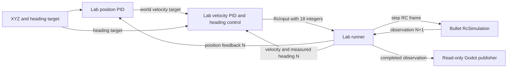

# Drone Lab control flow and RC boundary

Status: **Implemented and verified**. [Design menu](index.md) ·
[RC migration plan](../../plan/0023-rc-input.md) · [RC channel contract](rc-input.md)

Drone Lab owns its runner, six-waypoint position mission, local position/velocity
controllers and Godot composition. Bullet Drone owns RC decoding, stabilization,
mixing, actuator/propeller models and physics. The Python interface is in-process;
Godot is a separate read-only UDP viewer. Drone Lab has no recording/probe layer.

Position control bounds horizontal velocity to 1 m/s and vertical speed to 1 m/s,
reduced to 0.5 m/s during landing. Velocity PID requests acceleration, compensates
gravity, bounds tilt to 15°, rotates force using measured heading, and calculates
collective thrust. Wrapped heading error times 4/s produces a bounded yaw-rate
request. A shared `RcCodec` encodes roll/pitch angles, yaw rate, thrust and switches.
No calculated force is applied by Drone Lab.

The RC frame contains 18 integers in 1000..2000. AETR uses CH1 roll, CH2 pitch,
CH3 throttle and CH4 yaw rate. AUX1/CH5 high arms; AUX2/CH6 high selects angle,
low selects acro. Unassigned AUX channels are ignored. Configuration and integer
quantization are specified in the [RC guide](rc-input.md).

`RcSimulation(config, control_settings, vehicle)` exposes `reset()`,
`step(RcInput)`, `close()`, `timestep_s`, `last_command` and `allocation`.
It owns no repeated loop. Observation N generates one frame for step N+1;
the facade returns immutable feedback for that completed step. Invalid frames do
not advance physics. Runtime failures require reset; close is terminal.

Feedback provides world position/linear velocity, altitude as position Z,
body-to-world XYZW quaternion, world angular velocity, rotor speeds and
simulation-time/episode/step identity. World Z is up and body X forward/Y left/Z up.
The Lab runner checks identities and closes all owned resources on completion,
timeout, error or interruption. Arming and mode changes reset internal histories.

See [interface and cycle ownership](drone-lab-interface-and-cycle.md) and the
[application's detailed flow](../../../drone_lab/docs/position-control-flow.md).
Lower-level internal SI and rotor interfaces remain available to library
compositions; the RC facade accepts only RC input.
