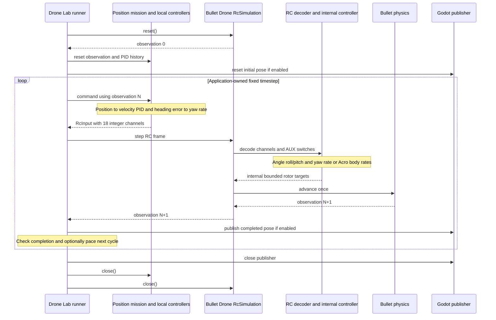

# Drone Lab / Bullet Drone interface and cycle ownership

Status: **Implemented and verified**. [Design menu](index.md) ·
[RC contract](rc-input.md) · [Control flow](drone-lab-control-flow.md)

**Drone Lab owns the repeated control cycle.** It computes local position and
velocity control and submits one `RcInput` to `RcSimulation.step()`. Bullet Drone
advances physics once and returns feedback. Both run in the same Python process;
Godot owns a separate rendering loop using read-only UDP poses.

| Responsibility | Owner |
| --- | --- |
| XYZ/yaw targets, arrivals, landing and disarm | Drone Lab mission. |
| Position → velocity → RC and heading-error feedback | Drone Lab controllers. |
| Reset, cycle ordering, completion, pacing and cleanup | Drone Lab runner. |
| RC channel decoding and AUX arm/mode selection | Bullet Drone. |
| Attitude/rate stabilization, mixing, actuators and physics | Bullet Drone. |
| Read-only snapshots and independent rendering | Publisher and Godot viewer. |

## Interface and one cycle

Construct `RcSimulation` with `SimulationConfig`, explicit
`InternalControlSettings`, and optional `VehicleParameters`. Its interface is:

| Operation/property | Result |
| --- | --- |
| `reset() -> DroneObservation` | Establish a fresh physics/control episode. |
| `step(RcInput) -> DroneObservation` | Validate channels, decode, stabilize and advance physics once. |
| `close()` | Release library resources; terminal and repeatable. |
| `timestep_s` | Fixed integration/control timestep. |
| `last_command`, `allocation` | Read-only diagnostics for the last completed step. |

Only RC frames enter the facade's step method. The frame uses AETR1234 with
18 integer channels in 1000..2000; AUX1 arms and AUX2 high selects angle. The yaw
channel commands turn rate in both modes. See the [RC guide](rc-input.md) for
scales, configuration and the migration from the removed joystick API.

Read-only feedback is `DroneObservation.ground_truth`: world position m and
linear velocity m/s, altitude as position Z, body-to-world orientation XYZW,
world angular velocity rad/s, and episode/step/simulation time. Observation N is
feedback for calculating step N+1. Sensor readings remain a separate field.

The timestep is 1/240 s in Drone Lab. Wall-time pacing belongs to the runner and
does not change integration. Invalid input is rejected before physics advancement;
runtime failures require reset. The runner attempts every cleanup on failure or
interruption and preserves the original exception. Godot uses port 9871 and can
remain open after the flight ends. No Lab recording, probes or extra examples are
introduced by this migration.
