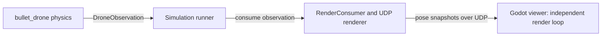

# Drone Lab / Bullet Drone interface and cycle ownership

Status: **Implemented and verified.** The previous architecture is retained below
for comparison; the application-owned cycle is the current implementation.

[Design menu](index.md) · [Control-flow design](drone-lab-control-flow.md) · [Documentation plan](../../plan/0020-drone-lab-interface-cycle.md) · [Implementation record](../../plan/0021-joystick-simulation-interface.md)

## Who owns the cycle?

**drone_lab now owns the runner and repeated simulation loop.** It computes
position control, feeds desired velocity into velocity control, and submits one
`JoystickInput` to `bullet_drone.simulation.JoystickSimulation`. The library
executes one simulation step and returns feedback; it does not start another loop.

Previously, drone_lab started bullet_drone's `SimulationRunner` and supplied
mission callbacks. The comparison below shows what moved in this milestone.

| Responsibility | Before this milestone | Implemented design |
| --- | --- | --- |
| Start/configure application | drone_lab | drone_lab |
| Repeated control/physics cycle and wall-time pacing | bullet_drone `SimulationRunner` | drone_lab runner |
| Mission targets and completion condition | drone_lab missions | drone_lab missions |
| Position → velocity → joystick calculations | bullet_drone controllers called by drone_lab missions | Separate drone_lab position and velocity controllers |
| Joystick translation, stabilization and mixing | bullet_drone | bullet_drone, inside the simulation facade |
| Force application and physics integration | bullet_drone | bullet_drone |
| Recording and selecting rendering consumers | drone_lab | drone_lab |
| Initiate cleanup of the run | bullet_drone runner | drone_lab runner |
| Release physics resources | bullet_drone environment/backend | bullet_drone facade and its internals |

The Python application and library run in one process using installed public
imports. Their interface is a set of Python method calls and immutable data, not
a network connection. Godot is a separate process with its own rendering loop.

## Previous call sequence (before this milestone)

Previously, drone_lab's `run_mission()` called the library runner, which reset
the components and repeated the following calls. This historical diagram shows
the position mission path; Drone Lab no longer uses it.

```mermaid
sequenceDiagram
    participant App as drone_lab application
    participant Runner as bullet_drone SimulationRunner
    participant Provider as bullet_drone FlightCommandProvider
    participant Mission as drone_lab PositionMission
    participant Control as bullet_drone controllers and SoftwareJoystick
    participant Env as bullet_drone environment and physics
    participant Consumers as recorder and render consumer
    App->>Runner: run(environment, provider, consumers, stop_when)
    Runner->>Env: reset()
    Env-->>Runner: initial DroneObservation
    Runner->>Provider: reset(observation)
    Provider->>Mission: reset(observation)
    Mission->>Control: reset controller and joystick
    Runner->>Consumers: reset(observation)
    loop Until max_steps or mission completion
        Runner->>Provider: command(observation N)
        Provider->>Mission: command(observation N, dt_s)
        Mission->>Control: controller.input(target, position, velocity, dt_s)
        Control-->>Mission: JoystickInput
        Mission->>Control: joystick.set_input(input); joystick.command(observation N, dt_s)
        Control-->>Mission: HighLevelCommand for N+1
        Mission-->>Provider: HighLevelCommand
        Note over Provider: Arm gate, attitude/rate control and mixing
        Provider-->>Runner: RotorCommand for N+1
        Runner->>Env: step(RotorCommand)
        Env-->>Runner: DroneObservation N+1
        Runner->>Consumers: consume(observation N+1)
        Note over Runner: Optional pacing, then stop_when(observation)
    end
    Runner->>Consumers: close()
    Runner->>Provider: close() forwards to mission and joystick
    Runner->>Env: close()
    Runner-->>App: final observation, or raise failure
    Note over App: Check timeout and verify recorded flight after cleanup
```

The previous application used a callback interface into drone_lab:
`HighLevelController.reset(observation)`, `command(observation, dt_s)` and
`close()`. Its mission implemented that contract and returned `HighLevelCommand`.
The provider converted it into `RotorCommand`, which the existing environment's
`step()` accepts. The old mission used the joystick, but the library step interface
exposed rotor commands. This API remains available for existing library consumers.

## Implemented interface: one joystick request, one feedback response

Import `JoystickSimulation` from `bullet_drone.simulation`. Construct it with
`SimulationConfig`, `InternalControlSettings` and optional `VehicleParameters`.
The facade exposes:

| Operation called by drone_lab | Result / responsibility |
| --- | --- |
| `reset() -> DroneObservation` | Reset the library simulation and return initial feedback. |
| `step(command: JoystickInput) -> DroneObservation` | Translate joystick input, run stabilization/actuators and advance physics once. Return the completed-step feedback. |
| `close() -> None` | Release library-owned resources. |

The facade encapsulates the joystick, command provider, mixing and environment.
Its read-only `timestep_s`, `last_command` and `allocation` properties provide
cycle timing and completed-step diagnostics. Optional stabilization, motor and
propeller contracts support passive probes and model injection. All application
flight commands must pass through `JoystickInput`, including arm/disarm; rotor targets and force
application remain inside bullet_drone.

```mermaid
sequenceDiagram
    participant Runner as drone_lab runner
    participant Mission as drone_lab mission
    participant Position as drone_lab position controller
    participant Velocity as drone_lab velocity controller
    participant Sim as bullet_drone JoystickSimulation
    participant Consumers as recorder and render consumer
    Runner->>Sim: reset()
    Sim-->>Runner: initial DroneObservation
    Note over Runner,Velocity: Reset mission, both controllers and consumers
    loop One application-owned cycle
        Runner->>Mission: command(observation N, dt_s)
        Mission->>Position: velocity(target position, measured position, dt_s)
        Position-->>Mission: desired world XYZ velocity in m/s
        Mission->>Velocity: input(desired velocity, measured velocity, yaw, dt_s)
        Velocity-->>Mission: JoystickInput with Angle RPY and thrust
        Mission-->>Runner: JoystickInput; disarmed phases return disarmed input
        Runner->>Sim: step(JoystickInput)
        Note over Sim: Joystick translation, stabilization, mixing, motors and one physics step
        Sim-->>Runner: DroneObservation N+1
        Runner->>Consumers: consume(observation N+1)
        Note over Runner: Check completion/timeout and pace the next iteration
    end
    Runner->>Consumers: close()
    Runner->>Mission: close()
    Runner->>Sim: close()
```

Position control produces velocity targets; velocity control produces joystick
commands through its acceleration-to-attitude/thrust conversion. The runner owns
the ordering of these calls. Controllers do not step physics, and the facade does
not choose position targets. See the [control-flow design](drone-lab-control-flow.md)
for the conversion and limits.

Feedback is `DroneObservation.ground_truth`: `position_m` and
`linear_velocity_m_s` are world-frame XYZ values in metres and m/s;
altitude is `position_m[2]`; `orientation_xyzw` is the body-to-world attitude
quaternion. `episode_id`, `step_index` and `simulation_time_s` correlate feedback
and commands. Observation N supplies the control calculation for step N+1;
the response is the result of that step. Feedback is immutable and read-only.

Both the runner and library use the same fixed `dt_s`. The current application
uses 1/240 s (240 physics steps per simulated second). Wall-time sleep belongs
to the runner and only controls pacing. It does not alter the integration timestep.
The facade validates input before advancing physics. Reset clears
episode/controller history; runtime failure stops the run, and the runner attempts
all cleanup on completion, failure or interruption.

## Where Godot fits

The runner delivers completed observations to the render consumer. The
bullet_drone `RenderConsumer` builds a read-only pose snapshot and its UDP renderer
publishes at the configured simulation-time rate. drone_lab selects/configures
these components; its Godot viewer normally listens on localhost port 9871.



Godot renders received poses and cameras. It neither advances the authoritative
physics nor owns the control cycle. Its rendering FPS can differ from physics and
publication rates. The Python runner can stop and close its publisher while the
independently launched Godot viewer remains open. Headless execution uses the
same control/physics cycle without a rendering consumer.
