# Internal flight control

Status: **Implemented and verified**

Milestone: **Internal stabilization and ideal actuator boundaries**

[Design menu](index.md) · [Saved plan and reference image](../../plan/0003-internal-flight-control.md) · [Rotor forces](rotor-forces-and-hover.md)

## Implemented flow

```mermaid
flowchart LR
    Source["HighLevelController\ncaller-supplied"] -->|HighLevelCommand| Provider["FlightCommandProvider"]
    Feedback["IdealStateFeedback\nread-only ground truth"] --> Provider
    Provider --> Internal["InternalFlightController"]
    Internal --> Angle["Angle: attitude P"]
    Angle --> Rate["Body-rate PID + optional feedforward"]
    Internal -->|Acro| Rate
    Rate -->|body torque| Wrench["WrenchCommand"]
    Provider -->|collective thrust bypass| Wrench
    Wrench --> Mixer["MotorMixer"]
    Mixer -->|RotorCommand: targets rad/s| Physics["PyBulletPhysics"]
    Physics --> Motors["MotorDynamics\nideal instantaneous ESC/motor"]
    Motors -->|actual rad/s| Props["PropellerModel\nideal thrust/reaction"]
    Props --> Apply["Offset rotor forces + reaction torque"]
    Apply --> Step["PyBullet step"]
    Step -->|DroneObservation| Feedback
    Step -->|DroneObservation| Source
```



The main CLI runs the reusable simulation; the altitude-controlled hover demonstration lives in `examples/hover`. The stabilization path is composed through the Python API. The subsequent [altitude demo](altitude-hover-demo.md) adds a software joystick and high-level takeoff/hover/landing mission through a separate example entry point. ADRC, Godot rendering, and Betaflight transport remain future work.

## Selection and composition

Optional YAML:

```yaml
control:
  backend: internal
```

Omitting the section or backend defaults to `internal`. `betaflight` is recognized but raises `UnsupportedControllerError` before world acquisition; the CLI returns 2. Unknown selectors or keys are configuration errors. `main()` and `create_flight_command_provider()` use the same backend check. Mixing and physics never select a controller.

Construct `InternalControlSettings` with explicit attitude gains, per-axis rate limits, and three `PidSettings` containing rate gains, torque output limits, and integral contribution limits. There are no tuned default gains. Optional rate feedforward defaults to zero. Gains and limits must be finite and nonnegative, with positive rate/output limits; integral limits cannot exceed output limits.

A caller implements `HighLevelController.reset(observation)`, `command(observation, dt_s)`, and `close()`. Supply that instance to:

```python
provider = create_flight_command_provider(
    config.control, high_level_controller, control_settings,
    vehicle, config.simulation.timestep_s,
)
final = SimulationRunner().run(
    DroneEnvironment(PyBulletPhysics(config, vehicle)),
    config.simulation.max_steps,
    command_provider=provider,
)
```

Import the factory from `bullet_drone.composition`, controller settings from `bullet_drone.controllers`, and `HighLevelCommand` from `bullet_drone.commands`. Use the same configured timestep for provider and physics. The source is responsible for producing the command for the observation's episode and next step. The altitude demo supplies a production high-level mission source; test fixtures also supply fixed sources.

## Commands, frames, and control

`HighLevelCommand(mode, rpy, thrust_n, episode_id, step_index, armed=True)` is immutable. Values must be finite; thrust cannot be negative. The provider validates commands before gating disarmed commands to zero motor targets; arming transitions clear stabilization history. Existing callers remain armed by default. Frames are right-handed: world Z up, body X forward/Y left/Z up. Quaternions are xyzw, mapping body to world.

- `angle`: RPY is body-to-world ZYX Euler orientation in radians, including absolute yaw heading. The attitude controller converts it to a quaternion and computes the shortest body-frame rotation vector. Per-axis P gains map angle error to body rates, limited by `max_rates_rad_s`. Equivalent quaternion signs produce identical errors; exact 180-degree ambiguity uses a deterministic sign.
- `acro`: RPY is desired body-axis angular velocity in rad/s. It bypasses attitude P and uses the same rate limits and PID loop.
- Collective thrust is in N along body +Z. It passes to the mixer directly; this controller does not compensate tilt or maintain altitude/position.

`IdealStateFeedback` reads ground truth without changing it, normalizes orientation, and rotates world angular velocity into body axes. It is an ideal control adapter, not an IMU model; the sensor slots remain empty. A caller can inject another `FeedbackSource` returning the same `ControlFeedback` units and frames.

The three rate PIDs return requested body torque in N*m. Rate Kp has units N*m/(rad/s), Ki has units N*m/rad, and Kd has units N*m/(rad/s²). Optional feedforward is coefficient × bounded rate target, with coefficient N*m/(rad/s).

The common scalar `PID` uses explicit `dt_s`, derivative on measurement (zero on the first update), bounded integral output contribution, and conditional integration: reject an integral increment that drives PID output saturation further; allow unwinding. Feedforward participates in the same output limits. Reset clears history; a control-mode change also clears rate PID history. No derivative filtering is modeled.

The existing mixer preserves collective and uniformly scales infeasible torque. `FlightCommandProvider.allocation` exposes the latest requested/achieved wrench and saturation. PID anti-windup handles its own output saturation; downstream mixer saturation does not back-calculate integrator state. Test gains verify local stabilization, not a calibrated flight envelope.

## Actuator and propeller boundaries

`MotorDynamics.reset()` returns four zero actual rotor speeds; `update(targets_rad_s, dt_s)` returns actual speeds in prop0–prop3 order. `IdealMotorDynamics` responds instantaneously, validates finite nonnegative targets and fixed positive dt, and rejects targets beyond the vehicle limit. Lag, battery/KV behavior, and electrical dynamics remain future work.

`PropellerModel.calculate(actual_speeds_rad_s)` returns `PropellerOutput`: four body-frame forces in N and aggregate body reaction torque in N*m. `IdealPropellerModel` composes the independently verified `RotorThrustModel` and `ReactionTorqueModel`: k_f*omega² along body +Z and signed k_m*omega² about body Z. Coefficients are converted from RPM² when reading vehicle parameters; no RPM crosses these APIs.

Inject models through keyword-only `motor_dynamics` and `propeller_model` arguments to `PyBulletPhysics`; ideal implementations are defaults. Physics validates actual speeds and all model output values before applying any force. Ground truth records actual speeds. Offset thrust already generates lever-arm roll/pitch torque; only rotor reaction torque is applied separately. PyBullet owns gravity and contact.

## Lifecycle and verification

The runner resets the environment, then the command provider. Provider reset clears controller state and latest allocation and resets the source. Each command must match the current episode/next step; replayed observations and stale commands are rejected before stabilization advances. Invalid source commands can be corrected and retried; component failures during feedback/stabilization/mixing require provider reset. Model failures invalidate the physics episode.

The optional runner `stop_when(observation)` predicate can finish a run after a completed step; predicate failures follow the same cleanup path. The runner owns closing provider and environment, attempts both even after cleanup failure/interruption, and preserves the original run failure. Repeated provider close is harmless. All providers, including the legacy hover provider, now implement reset/command/close; caller-defined providers must add those lifecycle methods.

Tests cover PID equations and anti-windup, selection rejection before acquisition, commands and feedback frames, quaternion wrapping/sign equivalence, Angle/Acro routing, thrust bypass/feedforward/limits, resets/replay, real PyBullet disturbance convergence on all three axes, ideal propeller equations, injected actual motor speeds, model failures/output rejection, and cleanup failures. Existing free-fall, hover, torque magnitude, and CLI checks remain applicable.
