# Position PID and virtual-joystick control-chain example

Status: **Implemented and verified**

[Design menu](index.md) · [Implementation plan](../../plan/0014-position-control-chain-example.md) · [Position controller](position-gate-demo.md) · [Stabilization](internal-flight-control.md)

## Run

```bash
uv run examples/position_control/main.py --headless
uv run examples/position_control/main.py --headless --trace /tmp/control-chain.csv
uv run examples/position_control/main.py --renderer godot
```

In VS Code, **Check position control chain (headless)** runs the complete validation quickly. **Run position control chain** uses the PyBullet GUI; **Run Godot and position control chain** starts Godot and the new example together. Existing hover and gate-flight examples remain available.

The CLI also accepts `--initial-position X Y Z`, `--renderer pybullet|none|godot`, `--render-config PATH` and optional `--trace PATH`. Default start is (0,0,0.015) m; Z must be ground-level in [0,0.03] m. XY waypoints are relative to the initial home. Godot uses DIRECT physics with wall-time pacing. Headless/none are unpaced. Invalid configuration exits 2, runtime/verification failures 1, interrupts 130 and successful verification 0.

## Control flow

```mermaid
flowchart LR
    Goal[XYZ position and yaw setpoint] --> Position[Position PID]
    Position -->|desired velocity m/s| Velocity[Velocity PID]
    State[Ground-truth position and velocity] --> Position
    State --> Velocity
    Velocity -->|acceleration m/s²| Force[Gravity compensation and tilt-limited world force]
    Force -->|Angle RPY radians and thrust N| Joy[Virtual joystick: SoftwareJoystick]
    Joy --> Source[HighLevelCommand and arm gate]
    Source --> Angle[Attitude P]
    Angle -->|target body rates rad/s| Rate[Rate PID]
    Rate -->|body torque N*m| Mixer[Motor mixer]
    Source -->|collective thrust N| Mixer
    Mixer -->|targets rad/s| Motors[Ideal ESC and motor dynamics]
    Motors -->|actual rad/s| Propellers[Propeller force and reaction torque]
    Propellers --> Physics[PyBullet force application and fixed step]
    Physics --> State
```



The new example uses the existing `PositionController`, `AltitudeController`, shared `PID`, `SoftwareJoystick`, `FlightCommandProvider`, `InternalFlightController`, `MotorMixer`, ideal motor/propeller implementations and `SimulationRunner`. It never writes a pose or velocity to move the drone. Every movement results from joystick commands, stabilization, rotor allocation and applied forces.

Position error produces desired velocity, which is compared with measured world velocity by the velocity PIDs. Their acceleration requests become world force, with gravity compensation and a 15° tilt bound. Converting force into Angle RPY for the requested yaw preserves world-direction control while heading changes. Collective thrust includes requested tilt compensation. The joystick uses SI Angle/thrust commands rather than normalized RC channels.

## Flight and acceptance

After 0.5 s disarmed settling, the mission visits these relative-to-home setpoints:

| Target | XY offset (m) | World Z (m) | Yaw |
| --- | --- | --- | --- |
| Takeoff | (0,0) | 3 | 0° |
| X leg | (2,0) | 3 | 0° |
| Y leg | (2,2) | 3 | 90° |
| Climb and return X | (0,2) | 4 | 180° |
| Return home | (0,0) | 3 | -90° |
| Align home | (0,0) | 3 | 0° |

The flight exercises positive and negative X/Y motion, climb/descent and all three stabilization axes. Advancement requires XYZ error <=0.12 m, total speed <=0.15 m/s and shortest attitude error <=0.05 rad continuously for 0.5 s. A lost tolerance restarts the dwell. Landing holds home XY, targets world Z=0, and limits descent to 0.5 m/s. Touchdown requires own-pad XY error <=0.12 m, height <=0.02 m and speed <=0.05 m/s continuously for 0.5 s. Motors are then disarmed for one simulated second before completion. Timeout is 120 simulated seconds and closes all owned resources.

The feedback is ideal ground truth. This example validates the current ideal control chain; it does not model sensors, position estimation, external device input, wind or obstacle avoidance. Godot scenery remains decorative and does not add physics contacts.

## Read-only outputs and tracing

`AltitudeController.last_output` is an immutable `AltitudeControlOutput` containing bounded velocity target, velocity-PID acceleration and vertical thrust. `PositionController.last_output` is immutable `PositionControlOutput`: world XYZ velocity target, raw velocity-PID acceleration before tilt clipping, and the resulting `JoystickInput`. Both are `None` before the first calculation and after reset. Invalid requests leave the previous output intact. The existing `thrust()` and `input()` APIs preserve their numerical outputs. Controllers do not configure diagnostics or persist telemetry.

Example-owned probes wrap the stabilization, motor and propeller contracts. Each delegates exactly once, records the returned values and preserves reset/stepping behavior. `ChainRecorder` is an observation consumer; it combines these values with the mission's joystick command and the provider's immutable allocation after each successful physics step.

Each immutable `ChainSample` contains:

- Completed physics state and preceding feedback state, with episode/step/time identity.
- Active target position/yaw, position/velocity PID output and episode-scoped joystick command.
- Body-rate feedback, stabilization wrench, requested/achieved mixer allocation.
- Target/actual rotor speeds and propeller forces/reaction torque.

For completed step N, the command targets N and feedback belongs to N−1. Telemetry therefore distinguishes the feedback used to compute control from the resulting state. Disarmed samples have no PID/stabilization/allocation output, avoiding stale armed-stage data; actuator and propeller outputs show zero.

Optional CSV records one row per completed step, with explicit SI-unit columns for these values. It is independent of Loguru phase/completion diagnostics. The output parent directory must exist. Write/open failures end the run with normal cleanup. `run_control_chain()` returns `ControlChainResult` with final observation, settled arrivals, samples and the verification report. The in-memory trace is intentionally retained for this short example; a long-run recorder should stream instead.

## Automatic chain checks and verification

After resources close, the example verifies all six settled targets, landing on the original pad, final disarm and zero rotor speeds. It checks command/feedback/physics identity at every step, joystick preservation of Angle/thrust, stabilization-to-mixer wrench, mixer-to-motor targets, ideal target/actual/physics speed equality, rotor limits and bounded horizontal velocity targets.

It independently sums body-frame rotor forces and lever-arm torque plus reaction torque, then compares the resulting wrench with the achieved mixer wrench. This validates the interfaces without applying a force twice. It also verifies that roll/pitch/yaw torque and both directions of X/Y motion were exercised. A broken link raises `ControlChainVerificationError` and returns failure instead of claiming success.

The verified default flight completes at 28.9625 simulated seconds, with six settled targets and 6,951 completed-step samples. Final XY error is about 0.000128 m, height about 0.01349 m and all rotor speeds zero. Tests additionally corrupt recorded links to confirm the verifier catches errors, check controller-output immutability/reset, heading dwell, replay/episode lifecycle, timeout/control/CSV failure and KeyboardInterrupt cleanup, and import-safe CLI behavior. The existing gate/hover and physics suite remains applicable.

The complete Python suite passes 259 tests. An actual wall-time-paced Godot run
also completed with the automatic chain checks and own-pad landing; the world
and attached camera views were captured and inspected during a yaw change.
