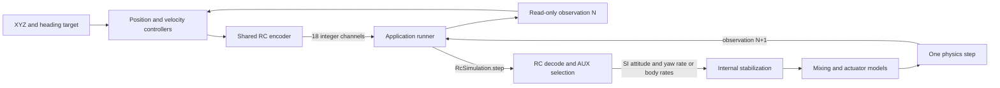

# 18-channel RC input

Status: **Implemented**. [Design menu](index.md) · [Plan](../../plan/0023-rc-input.md)

`RcSimulation` owns RC decoding, internal stabilization, mixing and one physics
step. The caller owns the loop and submits only `RcInput`. Feedback remains an
immutable `DroneObservation`; RC conversion never applies forces or changes poses.

## Channels and switches

`RcInput(channels)` accepts exactly 18 integer values in 1000..2000 and copies them
into an immutable tuple. Floats, booleans, missing channels and out-of-range values
are rejected. Channel numbers in configuration are one-based; tuple indices are
zero-based. The default frame has centered roll/pitch/yaw, low throttle and low AUX.

| Channel | AETR1234 function | Mapping |
| --- | --- | --- |
| CH1 | Aileron / roll | 1500 center, positive above center. |
| CH2 | Elevator / pitch | 1500 center, positive above center. |
| CH3 | Throttle | 1000 zero thrust, 2000 maximum collective. |
| CH4 | Rudder / yaw | 1500 zero body-Z rate in both modes. |
| CH5 / AUX1 | Arm | ≥1500 armed; below disarmed. |
| CH6 / AUX2 | Mode | ≥1500 angle; below acro. |
| CH7..18 / AUX3..14 | Unassigned | Accepted, ignored; encoder emits 1000. |

Positive values use body X forward, Y left, Z up and right-hand rotations.
In angle mode roll/pitch span ±45° by default, while yaw commands body Z rad/s.
In acro all axes command body rates. Rate scales come from
`InternalControlSettings.max_rates_rad_s`; throttle scale is four times the
vehicle's maximum rotor thrust. These scales are supplied to `RcCodec` explicitly.
An encoder and decoder must share scales and `RcSettings`.

Angle yaw has no absolute-heading hold. Neutral yaw requests zero turn rate;
roll/pitch stabilization constructs its attitude target at the measured heading
and replaces the yaw rate target with the RC demand. Internal `HighLevelCommand`
retains absolute-heading semantics unless `yaw_rate_rad_s` is supplied in angle
mode. Acro rejects this optional override.

## Configuration and encoding

The optional top-level `rc` YAML section is loaded by `YamlConfigLoader`:

```yaml
rc:
  aetr_channels: [1, 2, 3, 4]
  arm_channel: 5
  mode_channel: 6
  arm_threshold: 1500
  angle_threshold: 1500
  max_angle_rad: 0.7853981633974483
```

AETR assignments must permute CH1..4. Arm/mode use distinct AUX channels CH5..18.
Switch thresholds are integers in 1001..2000 so a low AUX value always disarms.
The angle limit must be positive and below π/2. Invalid configuration fails before
physics acquisition. Existing simulation configurations omit `rc` to use defaults.

```python
from bullet_drone.commands import RcInput
from bullet_drone.config import RcSettings
from bullet_drone.rc import RcCodec
from bullet_drone.vehicle import load_racer_parameters

vehicle = load_racer_parameters()
codec = RcCodec(4 * vehicle.max_thrust_per_rotor_n, (2, 2, 2), RcSettings())
# SI calculation to integer RC: roll/pitch radians, yaw body rate rad/s, thrust N.
frame = codec.encode('angle', (.1, -.1, .3), 9.81, True)
assert len(frame.channels) == 18
assert RcInput().channels[4] == 1000  # disarmed
```

`encode()` validates finite SI values, clips calculated demands to configured
bounds, and rounds to nearest integer using Python ties-to-even. `decode()` strictly
validates external frames and creates an identity-stamped internal command. No
silent clamping occurs at the incoming command boundary. One stick count represents
angle_limit/500 radians or rate_limit/500 rad/s; throttle resolution is
maximum_thrust/1000 N. Flight completion checks use tolerances, not exact timings.

## Loop, heading feedback and lifecycle



Drone Lab and library waypoint controllers compute heading rate from wrapped
heading error with gain 4 s⁻¹, bounded by the yaw-rate scale. Measured yaw, rather
than the destination heading, rotates the requested world force into roll/pitch.
This outer heading controller assumes nearly level flight; it is not a general
inverted-flight attitude controller.

The application calls reset, then repeats command/step using the fixed timestep,
then closes resources on success, error or interruption. Invalid RC frames are
rejected before physics/control advances and can be corrected. Runtime control
or physics failures require reset before reuse. Episode/step checks and arming/
mode resets retain existing behavior. There is no transport, RC failsafe, deadband
or expo in this milestone.

The old `JoystickInput`, `JoystickSimulation`, `SoftwareJoystick` and
`bullet_drone.joystick` APIs have been removed. Migrate to `RcInput`, `RcSimulation`,
`SoftwareRc` and `bullet_drone.rc`. Internal SI command/physics APIs remain available
for library composition; the public RC facade accepts only RC frames.
