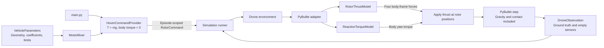

# Rotor forces, mixing, and ideal hover

Status: **Implemented**  
Milestone: **Mixer and ideal rotor forces, following gravity-only simulation**

[Design menu](index.md) · [Entry point](simulation-entry-point.md) · [Physics requirements](requirements/v0.1.0/physics.md)

## Goal and boundaries

Demonstrate open-loop hover using requested total thrust and body torque, a bounded motor mixer, and independent rotor thrust/reaction torque models. Preserve gravity-only runs and the existing `DroneObservation` API. The demo starts level and stationary; it is not a feedback controller and does not reject disturbances.

Each physical effect has its own named method or focused module and independent verification. Mixing requests actuator output; it does not calculate the net force after gravity and drag. The physics adapter applies forces and lets PyBullet integrate the body.

## Component diagram



## Interfaces and ownership

- `VehicleParameters` stores four rotor positions, body-reaction yaw signs, thrust/torque coefficients, and fixed motor capacity. `main.py` reads the bundled racer once and injects the same parameters into mixer and backend.
- `WrenchCommand` contains nonnegative collective thrust in N and body-frame roll/pitch/yaw torque in N·m.
- `MotorMixer.mix()` returns `MotorAllocation`: requested and achieved wrench, four rotor thrusts and speeds, torque scaling, and saturation status.
- `RotorCommand` contains four speeds in rad/s ordered prop0–prop3, episode identity, and the intended next step index.
- Environment and physics `step()` accept a rotor command or `None`. `None` means zero speeds for that step, not holding the last command. Rejected commands do not advance physics or invalidate an otherwise ready episode.
- The runner accepts an optional `CommandProvider`. The hover provider associates its constant allocation with the current observation's episode and next step. Command-provider failures follow the same cleanup path as backend failures.
- Ground truth includes `rotor_speeds_rad_s`. Reset sets speeds to zero; ideal motors change speed instantaneously on a successful commanded step. Sensor fields remain empty.

## Racer geometry and units

Body axes are X forward, Y left, Z up. Rotor positions are read from the URDF's propeller inertial origins, relative to the body center of mass. The fixed-joint origins and visual mesh transforms are not the rotor lever arms.

| Rotor | Position (m) | Body reaction yaw sign |
| --- | --- | --- |
| prop0, front left | `(0.085, 0.0675, 0)` | +1 |
| prop1, rear left | `(-0.085, 0.0675, 0)` | -1 |
| prop2, rear right | `(-0.085, -0.0675, 0)` | +1 |
| prop3, front right | `(0.085, -0.0675, 0)` | -1 |

The upstream coefficients multiply RPM squared. Convert both once using `(60 / (2π))²`, because public rotor commands use rad/s. The converted thrust coefficient is approximately `7.723714e-7 N/(rad/s)²`; the reaction coefficient is approximately `1.942327e-9 N·m/(rad/s)²`.

Derive nominal capacity from the URDF's 0.830 kg nominal mass, thrust-to-weight value 4.17, and reference gravity 9.81 m/s²: approximately 8.48835 N per rotor. Configured mass and simulation gravity change hover demand, not hardware capacity. This is a profile approximation, not a calibrated electrical model.

## Mixer and constraints

For thrust values `f0..f3`, the allocation matrix has rows:

- Total thrust: `1` for every rotor.
- Roll torque: each rotor's Y position.
- Pitch torque: negative X position.
- Yaw torque: reaction sign multiplied by `k_m / k_f`.

The mixer requires four identical actuators, balanced horizontal geometry and yaw signs, and an invertible allocation matrix. A small standard-library 4×4 solve avoids introducing a numerical dependency.

First clamp collective thrust to total capacity and divide it equally. Solve for zero-sum torque corrections, then uniformly scale those corrections until all rotor thrusts are between zero and capacity. This preserves the feasible collective request and reduces requested torque consistently. Return the actually achieved wrench and whether saturation occurred. At zero or maximum collective there may be no torque headroom.

Convert each feasible rotor thrust to speed with `ω = sqrt(f / k_f)`. Reject invalid numerical requests, malformed rotor commands, excessive speeds, and commands for another episode or step before applying forces. A saturated hover request is reported once by `main.py`; it does not silently claim that an overweight vehicle can hover.

## Force calculation and application

`RotorThrustModel.calculate()` produces `(0, 0, k_f ω_i²)` per rotor in body coordinates. The adapter applies those forces to the base at the declared rotor positions using `LINK_FRAME`. PyBullet rotates them with the vehicle and generates lever-arm roll/pitch torque. Do not separately apply `r × F` as another external torque.

`ReactionTorqueModel.calculate()` returns body yaw torque `sum(s_i k_m ω_i²)` and the adapter applies it to the base. All external forces and torques are reapplied before every physics step. Gravity and contact remain owned by PyBullet; built-in linear/angular damping stays disabled to avoid hidden effects in these checks.

## Configuration and execution

Optional `flight.mode` is `gravity` by default, or `hover`. Existing YAML remains valid. Hover requires downward vertical gravity and requests `T = mass × |gravity_z|` with zero torque.

```bash
uv run --locked bullet-drone --config configs/hover.yaml
uv run --locked bullet-drone --config configs/hover-headless.yaml
```

VS Code's **Run hover simulation** task uses the GUI example. GUI mode uses existing wall-time pacing; headless mode is unpaced. Both examples run 1,200 steps over five simulated seconds. With mass 1 kg and gravity 9.81 m/s², hover requires 2.4525 N per rotor, approximately 1,781.933 rad/s (17,016 RPM).

## Verification

Tests check ideal hover within 1 mm at every step over five seconds, zero drift and rotation from level rest, mass-dependent hover demand, independent force equations, body-frame thrust rotation, and quantitative roll/pitch/yaw response. First-step angular velocity is compared to `requested torque × dt / inertia`; this also detects double application of lever-arm torque.

Allocation tests cover feasible combined torque, zero/maximum collective, saturation, achieved output, and singular geometry. Command tests check invalid numbers, stale episodes/steps, replay, motor limits, unchanged state after rejection, and reset to stopped rotors. Force-application failures stop the episode and release the owned client. Earlier gravity-only and lifecycle tests remain applicable.

## Force and model roadmap

The final physics scope follows the [course's force inventory](https://github.com/amire2000/drone-physics-and-simulation-course/blob/main/docs/modules/06-autonomous-hover/index.md). Each effect should be verified before tuning a controller.

| Effect or model | Current status | Later responsibility |
| --- | --- | --- |
| Gravity and contact/friction | Delegated to PyBullet | Keep solver ownership; validate contact behavior. |
| Rotor thrust | Implemented | Extend the ideal curve with calibrated propeller data. |
| Lever-arm roll/pitch torque | Generated by offset thrust | Maintain geometry and avoid duplicate torque. |
| Rotor reaction yaw torque | Implemented | Calibrate the torque coefficient and spin signs. |
| Quadratic body drag | Pending | Independent body drag force model. |
| Rotor-dependent translational drag | Pending | Independent rotor-air drag model. |
| Angular damping | Pending | Explicit rotational resistance model. |
| Motor dynamics | Pending | Actual speed response to target speed; motor lag. |
| KV and battery behavior | Pending | Voltage, current, capacity, and actuator limits. |
| Wind | Pending | Air-relative velocity input to aerodynamic models. |
| Rotor inflow and blade flapping | Pending | Thrust modification and in-plane forces. |
| Propeller gyroscopic torque | Pending | Rotor angular momentum contribution. |
| Ground effect | Pending | Surface-dependent rotor thrust modification. |
| Prop wash / induced airflow | Pending, advanced | Local airflow shared by interacting rotors/vehicles. |

KV, voltage sag, motor lag, feedback control, drag, and advanced aerodynamics are outside this milestone. KV is not a thrust coefficient, and aerodynamic resistance to rotor spinning must not be confused with translational drag on the drone.
