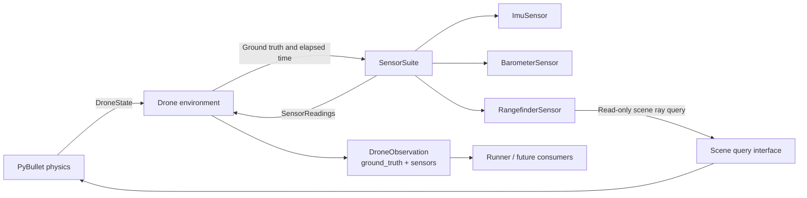
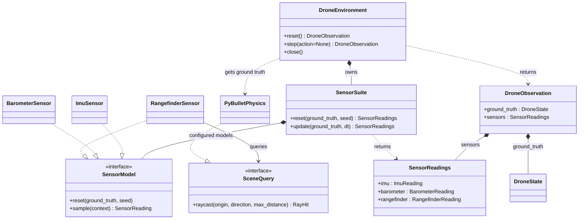

# Sensor package and drone observations

Status: **Draft; not implemented**  
Target: **Sensor milestone following the basic gravity-only entry point**

[Design menu](index.md) · [Entry-point design](simulation-entry-point.md) · [Overall architecture](architecture.md) · [Sensor requirements](requirements/v0.1.0/sensors.md)

## Goal

Introduce a future `bullet_drone.sensors` package with separate `ImuSensor`, `BarometerSensor`, and `RangefinderSensor` classes. Keep authoritative ground truth separate from simulated measurements that include noise and realistic measurement behavior.

Keep `DroneState` as the physics output. The environment returns `DroneObservation` from the first simulation milestone, containing two groups:

- `ground_truth: DroneState`: exact simulated pose, velocities, time, and step identity.
- `sensors: SensorReadings`: the latest IMU, barometer, and rangefinder readings, with their own timestamps and validity.

Noise changes sensor readings only. Rendering independently selects position, altitude and attitude sources; the implemented [rendering contract](godot-rendering.md) defaults to ground truth and rejects sensor selection before resources open until an estimator is implemented. Future controllers use sensor readings when evaluating behavior under measurement uncertainty. Recording can save both for comparison. No state estimator or sensor fusion is included in this milestone.

## Component diagram

## Class diagram

The diagram represents the sensor milestone. The gravity-only entry point already returns `DroneObservation` with all sensor reading fields set to `None`; this extension populates those fields without changing the return type. The runner and completion reporting continue to use `DroneObservation.ground_truth`. `main.py` constructs and injects the sensor suite; the CLI parser remains an argument helper. GUI or headless connection mode does not change the observation contract.

The physics lifecycle contract stays unchanged. Scene queries are a separate read-only interface so sensors do not receive client IDs or import PyBullet. Queries never step or mutate the world. The adapter must ignore the drone's own collision geometry when tracing the rangefinder beam.

## Initial sensor behavior

| Class | Ideal measurement | Simulated output |
| --- | --- | --- |
| `ImuSensor` | Specific force and angular velocity in sensor coordinates. | Three-axis accelerometer in m/s² and three-axis gyroscope in rad/s, each with independent configurable bias and noise. |
| `BarometerSensor` | Atmospheric pressure from ground-truth altitude and a reference atmosphere. | Noisy pressure in Pa and altitude in meters derived from that same pressure and reference. |
| `RangefinderSensor` | Distance along the configured beam to the first scene hit. | Noisy range in meters or an explicit invalid/no-return reading. |

### IMU

Mount the initial IMU at the body center of mass, aligned with body axes. Compute world-frame acceleration from consecutive physics-step velocities. Subtract world-frame gravity, then rotate into sensor coordinates: `specific_force = R_world_to_sensor × (acceleration_world - gravity_world)`. Rotate world angular velocity into the same sensor frame for the gyroscope.

With zero noise and bias, a level stationary drone under gravity reads approximately positive gravity magnitude on accelerometer Z; a freely falling drone reads approximately zero specific force. Do not return ground-truth orientation as an IMU measurement. Offset mounting, vibration, and lever-arm acceleration are later extensions.

Compute velocity differences every physics step, even when the IMU samples less frequently. At reset there is no acceleration interval: mark the initial IMU reading `not_ready` until the first completed step rather than inventing an acceleration value.

### Barometer

Use a simple constant-temperature atmosphere for the initial model. Configure reference pressure `p_ref`, reference altitude `z_ref`, and temperature `T`. For height `h = z - z_ref`, use `p = p_ref × exp(-g_ref × h / (R_air × T))`, then add pressure bias and noise. Derive reported altitude using the inverse of this same model and the same reference parameters.

This is a proposed approximation, not a calibrated weather model. `g_ref` is the positive reference atmospheric gravity, independent of experiments that alter simulation gravity; `R_air` is the specific gas constant for dry air. Reject nonpositive temperature/reference pressure. If the noisy pressure is nonpositive, return an invalid reading instead of evaluating a logarithm.

### Rangefinder

Use one ray, initially oriented along body negative Z, from a configured mounting position outside the drone collision geometry. Transform the origin and direction using ground-truth pose. Measure the first non-drone surface along the beam; this is slant distance and is not always vertical altitude.

Configure minimum and maximum range. A miss produces `no_return` and no numeric range; a hit below the minimum produces `out_of_range`. Apply noise only to valid ideal hits, then mark a noisy result outside the limits as invalid rather than substituting maximum range. Scene geometry, tilt, and occlusion determine the ideal hit; do not implement range as simply drone Z position.

## Noise, scheduling, and data contract

Start with additive fixed bias and zero-mean Gaussian white noise: `reading = ideal + bias + noise`. Standard deviation is configured per sample in the output's units; it is not a spectral noise density. Vector quantities support per-axis settings. Zero bias and zero noise produce the ideal measurement. Bias drift, latency, quantization, saturation, dropout, and temperature-dependent behavior can be added later; initial readings do not claim complete hardware fidelity.

Separate ideal measurement conversion from the noise model. A reusable `GaussianNoiseModel` can provide the first implementation without coupling sensor classes to physics equations. Each sensor has its own seeded random stream keyed by run seed and stable sensor identity. Adding or disabling another sensor must not change an existing sensor's noise sequence.

Each sensor is configured with enabled status and sample rate. In the initial implementation, rates must divide the physics rate into an integer number of steps; reject unsupported rates rather than silently rounding. Sampling follows simulation time, never wall time. Between updates, retain the previous reading with its original timestamp and source step index. Disabled sensors produce no reading. Reset clears cached samples and schedules and starts fresh episode-scoped random streams derived reproducibly from the configured seed and episode sequence.

Every immutable reading includes sensor identity, episode identity, measurement time, source step index, status, and values with declared units and frame. IMU, barometer, and rangefinder have distinct typed reading records. Expected measurement conditions such as no hit produce statuses; configuration or backend errors are failures, not noisy measurements. `SensorReadings` groups the latest records without implying that all three sampled simultaneously.

The sampling context provides ground truth, gravity, per-step acceleration when available, elapsed simulation time, and a narrow scene-query service where required. It carries no live PyBullet objects.

Configurable Gaussian noise and separate pressure/IMU/range sensing have established simulation precedents; see the official [Gazebo Sensors overview](https://gazebosim.org/libs/sensors/). This reference informs the modeling approach and does not introduce a Gazebo dependency.

## Acceptance checks

- Sensor updates leave physics state and scene snapshots unchanged.
- Zero-noise IMU reads positive Z specific force at level rest and near zero in free fall; gyroscope matches known rotations in the declared frame.
- Barometer pressure decreases with height; zero-noise pressure/altitude conversion round-trips using the configured reference.
- Rangefinder matches ground and obstacle geometry at known poses, including tilt, misses, and operating-limit cases; self-hits are excluded.
- Fixed seeds reproduce samples, and changing another sensor does not change an existing stream. Statistical checks verify mean and variance with declared sample counts and tolerances.
- Mixed sensor rates preserve timestamps and previous values between samples; reset clears old-episode data, and disabled sensors have no reading.
- Initial IMU acceleration is explicitly unavailable; invalid readings never fabricate usable values.
- Environment observations carry separate immutable ground-truth and sensor groups, and consumers select the group they need.

Sensor rates, calibrated noise/bias values, reference atmosphere, and range limits must be chosen for a concrete sensor profile before implementation acceptance. This revision adds design documents only; it does not create sensor code or install dependencies.
