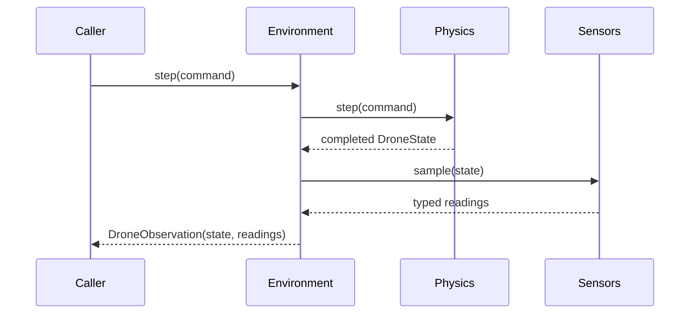

# IMU and barometer sensors

`RcSimulation.reset()` and `step()` return measurements in
`DroneObservation.sensors.imu` and `.barometer`. Both sensors are enabled with
zero noise by default. A disabled sensor returns `None`; rangefinder is not
implemented and remains `None`. Measurements are frozen dataclasses stamped with
`episode_id`, `step_index` and `simulation_time_s` matching their source state.
The containing observation supplies `ground_truth.drone_id`.

## Ownership and interfaces

`ImuSensor` and `BarometerSensor` live in `bullet_drone.sensors`. Their small
`Sensor[Reading]` contract provides `reset(state)` and `sample(state)`, each
returning a reading. They consume immutable project-owned `DroneState` values and
have no PyBullet or rendering dependency. They cannot apply forces or change
physics. No scene queries are needed for these two sensors.

`RcSimulation` builds sensors from `SimulationConfig.sensors` and passes them to
`DroneEnvironment`. Direct environment users explicitly inject sensor instances:

```python
from bullet_drone.environment import DroneEnvironment
from bullet_drone.sensors import BarometerSensor, ImuSensor

# physics is an existing PhysicsBackend; config is its SimulationConfig.
environment = DroneEnvironment(
    physics,
    imu=ImuSensor(config.simulation.gravity_m_s2, config.sensors.imu),
    barometer=BarometerSensor(config.sensors.barometer),
)
try:
    initial = environment.reset()
    observation = environment.step()
    imu = observation.sensors.imu
    barometer = observation.sensors.barometer
finally:
    environment.close()
```

Direct injection determines whether a sensor runs; the `enabled` configuration
flag controls assembly by `RcSimulation`. An environment without injected sensors
retains empty sensor slots. Controllers and examples continue using ground truth;
an IMU does not produce an attitude estimate. See
[VectorNav's IMU/INS/AHRS definitions](https://www.vectornav.com/resources/inertial-navigation-primer/theory-of-operation/theory-inertial).



## IMU measurement model

`ImuReading.specific_force_m_s2` and `.angular_velocity_rad_s` use body axes:
X forward, Y left, Z up. Mounting is aligned with the body at the center of mass.
Let `R` be the body-to-world orientation and `g_world` the configured physics
gravity vector:

```text
a_world = (velocity_current - velocity_previous) / (time_current - time_previous)
f_body = transpose(R_current) * (a_world - g_world)
gyro_body = transpose(R_current) * angular_velocity_world
```

At reset there is no velocity interval. The agreed initial assumption is zero
world acceleration, so a level drone in Earth gravity initially reports upward
specific force even if it starts airborne. Subsequent free-fall samples report
approximately zero specific force; stationary support/hover reports approximately
+9.81 m/s² on body Z. Gyro data comes from current world angular velocity rotated
to body axes. Noise and bias are applied in body axes after transformation.

The IMU uses [shared frame math](frame-math.md) from `bullet_drone.geometry`,
independently of controllers and command-private validation. Invalid source
vectors/quaternions raise `GeometryError` (a `ValueError`), rather than
`InvalidCommandError`; source-state geometry failures require environment reset.

Acceleration is an interval average expressed in the current frame. Contact
impulses can therefore produce large readings. No clipping, lever-arm effects,
filtering, magnetometer or orientation estimator is modeled.

## Barometer measurement model

`BarometerReading.pressure_pa` is measured atmospheric pressure;
`.altitude_m` is world Z inferred from that measured pressure. For reference
pressure `p_ref`, temperature `T_ref` and world height `z_ref`:

```text
H = R_air * T_ref / g_atmosphere
p_ideal = p_ref * exp(-(z_world - z_ref) / H)
p_measured = p_ideal + pressure_bias + Gaussian(0, pressure_stddev)
z_measured = z_ref - H * (log(p_measured) - log(p_ref))
```

Defaults are `p_ref = 101325 Pa`, `T_ref = 288.15 K`, `z_ref = 0 m`,
`R_air = 287.05 J/(kg K)` and `g_atmosphere = 9.80665 m/s²`. Atmospheric gravity
is fixed to Earth values independently of simulation gravity. This is a local
constant-temperature approximation for the low-altitude demos; it omits the
layers and temperature gradients in
[NASA's atmosphere model](https://www.grc.nasa.gov/WWW/K-12/airplane/atmosmet.html).
It does not feed density back into rotor physics. Weather, rotor wash and
thermal drift are outside this milestone.

Pressure noise is applied once; altitude has no independent noise. Nonpositive
or nonfinite measured pressure and unrepresentable model outputs raise errors;
they are not silently clipped or resampled.

## Configuration and noise

All fields are optional. Python settings are `SensorsSettings`, `ImuSettings`
and `BarometerSettings` from `bullet_drone.config`. For example:

```python
from bullet_drone.config import BarometerSettings, ImuSettings, SensorsSettings

sensors = SensorsSettings(
    imu=ImuSettings(gyro_stddev_rad_s=(0.001, 0.001, 0.001), seed=0),
    barometer=BarometerSettings(pressure_stddev_pa=1.0, seed=1),
)
# Pass sensors=sensors when constructing SimulationConfig.
```

Equivalent YAML, with the remaining configuration fields shown:

```yaml
sensors:
  imu:
    enabled: true
    accelerometer_stddev_m_s2: [0.01, 0.01, 0.01]
    accelerometer_bias_m_s2: [0.0, 0.0, 0.0]
    gyro_stddev_rad_s: [0.001, 0.001, 0.001]
    gyro_bias_rad_s: [0.0, 0.0, 0.0]
    seed: 0
  barometer:
    enabled: true
    pressure_stddev_pa: 1.0
    pressure_bias_pa: 0.0
    reference_pressure_pa: 101325.0
    reference_temperature_k: 288.15
    reference_altitude_m: 0.0
    seed: 1
```

These nonzero noise values illustrate configuration, not calibrated hardware.
Omitted standard deviations and biases are zero. Standard deviations are finite
and nonnegative, vectors have three finite components, reference pressure and
temperature are positive, `enabled` is strictly boolean, and seeds are integers
(excluding booleans). Unknown YAML keys are rejected.

Each measurement component receives additive fixed bias plus an independent
Gaussian draw. Standard deviations are **per sample**, not noise densities;
changing timestep does not scale them. Each sensor owns a private standard-library
random generator. Default seeds differ between sensors; use distinct seeds across
drones when independent noise is wanted. Identical seeds and sampling patterns
produce identical random streams. Reset restarts both history and seeded noise.

## Lifecycle and telemetry

Reset returns fresh readings for both sensors. Each successful step produces
fresh readings after physics advances. No independent sampling rates, delayed
samples or wall-clock timing are involved. Direct sensor sampling requires reset,
matching drone/episode identities, and strictly increasing step and finite time.
Reset accepts a new identity and starts a new measurement history.

A sensor error during reset leaves the environment unready. A sensor error after
physics advances invalidates the current episode: reset is required before the
next step, and the failed observation is not returned. Callers still own cleanup
with `close()`. Sensor objects own no external resources.

The `simulation/sensors` schema uses the [shared telemetry header](telemetry.md)
and a `data` object with typed IMU/barometer slots and a null rangefinder slot.
Disabled readings remain null. Embedded readings retain their measurement episode,
step and simulation time. Schemas do not collect readings or start a recorder;
applications can convert the immutable sensor dataclasses to JSON-compatible data.

Tests cover physical formulas, frames, bias/noise statistics and repeatability,
configuration validation, lifecycle, payloads and unchanged physics with sensors
enabled/noisy/disabled. Run `uv run --locked pytest -q tests/test_sensors.py`.
