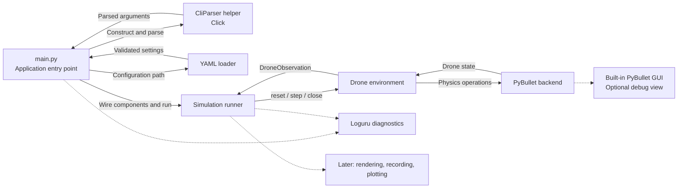
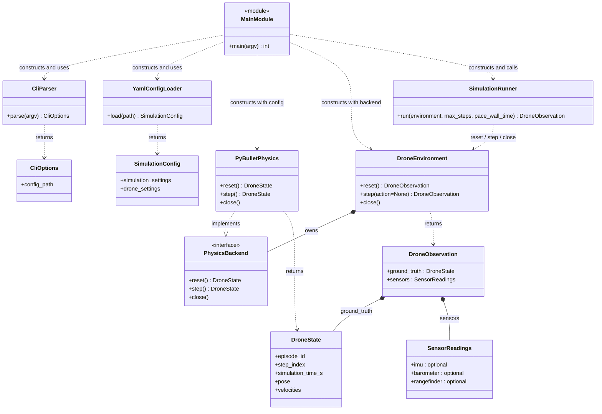

# First simulation entry point

Status: **Implemented and verified**
Target: **First incremental milestone toward 0.1.0**  
Date: **2026-10-13**

[Design menu](index.md) · [Overall architecture](architecture.md) · [Project guidance](../../AGENTS.md)

## Goal and scope

Provide a small simulation entry point with GUI and headless modes that parses CLI arguments, loads YAML configuration, creates an environment, and repeatedly calls its step method. Adopt the environment lifecycle idea from [gym-pybullet-drones BaseAviary](https://github.com/learnsyslab/gym-pybullet-drones/blob/main/gym_pybullet_drones/envs/BaseAviary.py) without depending on Gymnasium.

The first simulation milestone demonstrates gravity acting on a simple drone body with ground contact. It establishes the component boundaries before adding rotor thrust and torque equations. It is a subset of the broader 0.1.0 requirements, not completion of that release scope.

The environment returns `DroneObservation` from the first milestone, with `ground_truth: DroneState` and an empty `sensors: SensorReadings` group. The [sensor extension](sensors.md) populates that group in a subsequent milestone without changing the environment return type. Physics continues to return `DroneState`.

This document describes the implemented first milestone. The broader 0.1.0 architecture and later sensor milestone remain planned.

The subsequent [rotor forces and hover milestone](rotor-forces-and-hover.md) is also implemented. The diagrams below retain the basic entry-point structure; current `step()` additionally accepts episode-scoped `RotorCommand` actions, and the runner supports an optional command provider. `None` retains gravity-only behavior. Optional YAML `flight.mode` selects `gravity` (default) or `hover`.

The [internal flight-control milestone](internal-flight-control.md) adds optional YAML `control.backend` (default `internal`); selecting `betaflight` raises an unsupported-controller configuration error before acquiring a world, with CLI status 2. Stabilization is API-only; CLI gravity and open-loop hover remain unchanged. Command providers now implement reset/close, and the runner resets and closes both provider and environment through the documented lifecycle.

## Basic block diagram

Solid arrows describe the main execution and state flow. Dashed arrows show diagnostics and future consumers.



## Components and interfaces

| Component | Responsibility |
| --- | --- |
| `main.py` | Own startup: instantiate the CLI helper, configure diagnostics, load configuration, wire components, start the runner, and translate completion or failure into an exit status. |
| `CliParser` helper | Parse `--config` and handle help/usage validation using Click; return `CliOptions`. It does not load YAML, configure logging, create physics resources, or start simulation. |
| YAML loader | Use PyYAML safe loading, validate settings, and return project-owned configuration records before any physics connection is opened. |
| Runner | Receive a configured environment, reset it, execute the configured number of steps, and always close resources. |
| Drone environment | Provide the public lifecycle API and delegate physical operations to the backend. It does not parse CLI arguments or YAML. |
| PyBullet backend | Own its configured GUI or headless client, ground, drone body, fixed timestep, and state extraction. It does not import CLI or configuration-file parsing libraries. |

The environment is composed with a physics backend through a small project-owned contract. Do not introduce an inheritance hierarchy or plugin registry for this milestone.

## Class diagram and relationships

`MainModule` represents `main.py` and its function, not a class to implement. Dashed arrows show usage; the filled diamond shows ownership of the backend lifecycle.



`main.py` is the composition point: it constructs `CliParser`, calls `parse(argv)`, passes the resulting path to `YamlConfigLoader`, then constructs the backend, environment, and runner. The runner knows nothing about Click or YAML. `CliParser` uses Click in non-standalone mode so parsed values return to `main()`; help and usage exceptions are translated into exit statuses by `main()` without starting simulation.

The backend initializes its owned world on reset; construction stores validated configuration without opening a client. This lets the runner own reset and cleanup consistently. The physics interface above is the minimum contract for this gravity-only milestone; later initialization and observation operations follow the overall architecture as their scope is implemented.

| Public environment operation | Behavior |
| --- | --- |
| `reset() → DroneObservation` | Restore initial conditions and return step zero at simulation time zero. Reset establishes a new episode identity consistent with the overall architecture. |
| `step(action=None) → DroneObservation` | Advance exactly one fixed physics step and return the resulting state. |
| `close() → None` | Release owned resources. Repeated calls are harmless. |

The original milestone accepted only `None`. Current actions are `RotorCommand` or `None`; invalid actions are rejected before force application or stepping. The [rotor milestone](rotor-forces-and-hover.md) specifies units, limits, episode validation, and allocation behavior while preserving the loop structure.

`DroneState` is an immutable project-owned record containing episode identity, step index, simulation time, position, quaternion orientation ordered `(x, y, z, w)`, and world-frame linear and angular velocity. No PyBullet handles or mutable backend references escape the backend. `DroneObservation` and `SensorReadings` are also immutable; initially all three optional sensor reading fields are `None`.

Use the overall architecture's SI units and right-handed world frame with Z up. Initial orientation is identity and velocities are zero. Access before reset or after close produces a clear lifecycle error. A backend failure ends the run; no successful state is returned for a failed step.

## Configuration and execution

The registered command is:

```bash
uv run bullet-drone --config configs/basic.yaml
```

The console script targets `bullet_drone.main:main` in `src/bullet_drone/main.py`. Direct module execution via `uv run python -m bullet_drone.main --config configs/basic.yaml` calls the same function through its module guard. Importing `main.py` must not parse arguments, configure logging, or start simulation.

`--config` is required and identifies an existing readable YAML file. This milestone has no CLI overrides of individual simulation settings.

The GUI example in `configs/basic.yaml` is:

```yaml
simulation:
  timestep_s: 0.004166666666666667
  max_steps: 1200
  gui: true
  gravity_m_s2: [0.0, 0.0, -9.81]

drone:
  mass_kg: 1.0
  initial_position_m: [0.0, 0.0, 1.0]
```

Require the timestep, step count, gravity, mass, and initial position fields. `simulation.gui` is an optional boolean, defaulting to `false` when omitted. Reject unknown keys, invalid types, nonfinite numbers, nonpositive mass or timestep, and nonpositive or noninteger step counts. Vector fields require exactly three finite numeric values. Boolean values must not be accepted as numbers. Report invalid settings before connecting to PyBullet.

Load the bundled racer URDF adapted from [gym-pybullet-drones](https://github.com/learnsyslab/gym-pybullet-drones/blob/01563120e060c9233a61f9cf00e6d4e5a8b331ab/gym_pybullet_drones/assets/racer.urdf). Package its body and four individual propeller meshes with the Python distribution so execution requires no network or Gymnasium dependency. Front means body positive X: `prop0_link` and `prop3_link` are orange; the rear pair are blue. See the [asset notes](../../src/bullet_drone/assets/racer/README.md) for provenance, licensing, and reproducible generation.

Preserve the upstream collision cylinder, radius 0.06 m and height 0.025 m, and the fixed massless propeller links. Load the URDF inertia explicitly, override base mass using `drone.mass_kg`, and scale the inertia diagonal by the ratio of configured mass to nominal URDF mass (0.830 kg). Rotor parameters in the asset are not applied as forces in this milestone. Create a static ground plane at Z = 0.

Application startup and execution follow this sequence:

1. `main()` constructs `CliParser` and obtains parsed arguments; help or usage errors exit here.
2. `main()` configures Loguru, then loads and validates YAML through the loader.
3. `main()` constructs the backend, environment, and runner, and calls the runner with the configured step count and a wall-time pacing flag equal to `simulation.gui`.
4. The runner resets the environment, creating its owned PyBullet `GUI` client when `gui: true`, or `DIRECT` client otherwise. Automatic real-time stepping remains disabled in both modes. The initial observation wraps the initial ground truth and empty sensor readings.
5. The runner calls `step()` exactly `max_steps` times unless interrupted or a failure occurs.
6. The runner closes the environment on completion, interruption, and failure, then returns the final observation on success. Initialization must also release any partially acquired resources on failure.
7. `main()` reports completion and a final state summary from `observation.ground_truth`, or an actionable error, and returns the appropriate exit status.

GUI mode paces the runner approximately to wall time using monotonic deadlines so the falling body can be observed. Sleep only when ahead of schedule; when behind, continue with the same fixed step without skipping steps or changing the timestep. Headless mode runs as fast as possible. Simulation time always equals completed steps multiplied by the configured timestep. The example runs for five simulated seconds. The viewer closes when the run completes; there is no extra keep-open loop.

### GUI boundary

For this milestone, GUI mode uses PyBullet’s built-in viewer in the same process as physics. It is a debug view of the ground and racer model, not the later independent rendering component. Load the drone's visual and collision geometry from the URDF and set an initial camera framing the body and ground. The runner never manipulates camera state.

GUI mode requires a usable display. Failed GUI connection or unexpected viewer disconnection ends the run with a reported runtime failure and cleanup; do not silently switch to headless mode. Headless stepping remains usable without a display. The built-in GUI connection behavior is documented in the [official PyBullet quickstart guide](https://github.com/bulletphysics/bullet3/blob/master/docs/pybullet_quickstart_guide/PyBulletQuickstartGuide.md.html).

## Logging and errors

Use Loguru for application diagnostics and configure its stderr sink once in `main.py`, with INFO as the initial level. Library components may emit diagnostics but must not add, remove, or configure sinks. Avoid logging every physics step.

Report successful completion with step count, simulated duration, and final position. Click handles command usage and invalid configuration as exit status 2. Runtime failures produce an actionable diagnostic and exit status 1. Ctrl+C closes the environment and exits with status 130. Successful completion exits with status 0.

Diagnostic logging does not replace telemetry recording. Structured state remains the boundary for later rendering, recording, and plotting consumers.

## Dependencies and boundaries

Click, Loguru, PyYAML, and PyBullet are installed runtime dependencies managed with uv and the synchronized lockfile. pytest is a development dependency. Configuration and state use standard-library immutable data records; no validation framework is required.

Do not add Gymnasium spaces, rewards, termination tuples, rotor forces, a controller, a separate renderer, or telemetry recording in this milestone. A future Gymnasium adapter can wrap the environment without coupling the basic simulation API to reinforcement-learning conventions.

## Acceptance checks for implementation

- Valid YAML loads; malformed, missing, unknown, or invalid settings fail before physics initialization.
- Click exposes help and requires `--config`; configured exit statuses distinguish usage, runtime failure, interruption, and success.
- `main()` instantiates and uses `CliParser`; the helper only returns arguments. Both console-script and module entry points use `main()`, and importing the module has no startup side effects.
- Reset restores initial pose, zero velocities, step count, and simulation time, with a new episode identity.
- Each step advances time once; previously returned observations remain unchanged, and their sensor fields are empty in this milestone.
- GUI mode displays the body and ground and uses wall-time pacing; headless mode needs no display. Both use the same fixed-step physics and observation contract.
- GUI connection failure or early disconnection reports failure and cleans up without fallback.
- A gravity-only body falls before contact and settles against the ground within an agreed numerical tolerance.
- Invalid actions leave simulation state and time unchanged.
- Normal completion, interruption, initialization failure, and stepping failure release the owned physics client.
- Loguru configuration occurs only at the application entry point; importing the environment does not configure global logging.

Implemented tests use 240 Hz physics, 50 solver iterations, zero linear/angular damping, and zero restitution. Free-fall position is compared to the continuous analytical solution within 3 mm after 0.1 seconds, allowing for semi-implicit integration error; vertical velocity is checked within 1e-6 m/s. After five seconds, the racer cylinder center must be within 1 mm of its 12.5 mm half-height and vertical speed below 0.001 m/s. Additional checks cover front/rear propeller colors, configured mass and inertia scaling, and cleanup after URDF loading fails. GUI and headless commands are smoke-checked with the bundled model.
