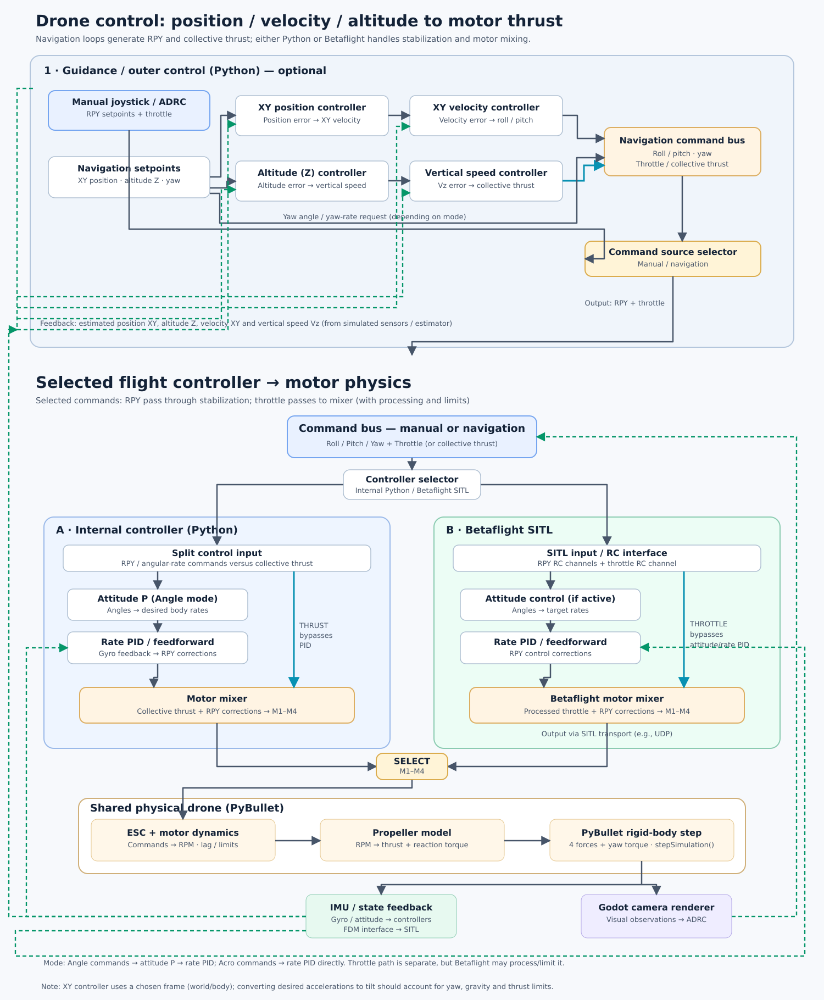
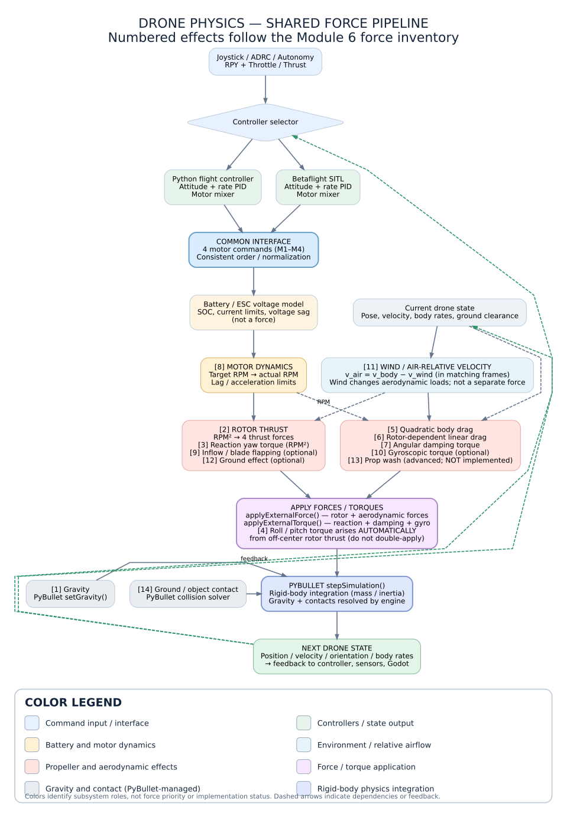

# Drone Simulation Architecture — Physics & Control Review

**Print-ready review | 13 October 2026**  
**Scope:** PyBullet rigid-body physics + Godot camera + switchable Python flight controller / Betaflight SITL.

## 1. Architecture overview

Joystick/ADRC inputs (roll, pitch, yaw, throttle) either drive a local Python controller or a Betaflight SITL bridge. Both produce **four normalized motor commands in a consistent motor order**. Shared physics then models battery/ESC → motor RPM + lag → propeller/aerodynamic forces → PyBullet → simulated sensors and Godot.

**Control distinction:** angle commands require an outer attitude loop before rate PID; rate commands (e.g. Acro) enter the rate loop directly. Collective throttle/thrust goes to the motor mixer, rather than through RPY PID (though a vertical-velocity controller can generate the collective command).

**Autonomy:** XY position → XY velocity → requested tilt/acceleration; altitude → vertical velocity → collective thrust. Thrust/tilt coupling and saturation require attention.

## 2. Shared physics sequence and color legend

The following original SVG includes index labels and a functional color legend. Colors indicate **subsystem role**, not force priority or whether implemented.

## 3. Force/effect inventory and implementation

**Index numbers are preserved from the reviewed course inventory.** Items 8 and 11 are contributing phenomena, not direct forces; 14 is added for contact.

| # | Effect | Component | PyBullet / placement | Course priority | Physical note |
|---|---|---|---|---|---|
| 1 | Gravity | World / PyBullet | setGravity() | Essential | mg, downward |
| 2 | Rotor thrust | Propeller model | applyExternalForce() per rotor | Essential | T = kT × RPM² |
| 3 | Reaction yaw torque | Propeller model | applyExternalTorque() | Essential | Q = sign × kQ × RPM² |
| 4 | Roll/pitch lever torque | Rotor placement / rigid body | Automatic via off-center thrust | Essential | r × F; never add twice |
| 5 | Quadratic body drag | Body aerodynamics | applyExternalForce() | Essential | Opposes air-relative speed |
| 6 | Rotor-dependent drag | Rotor aerodynamics | applyExternalForce() | Essential | Depends on RPM and airspeed |
| 7 | Angular damping | Body aerodynamics | applyExternalTorque() | Recommended | Opposes body angular rate |
| 8 | Motor lag / dynamics | ESC + motor | Update RPM state (no direct force) | Recommended | First-order RPM response |
| 9 | Rotor inflow / blade flapping | Propeller aerodynamics | Change thrust; apply in-plane force | Optional | Forward-airflow effects |
| 10 | Propeller gyroscopic torque | Rotor dynamics | applyExternalTorque() | Optional | Body-rate / rotor momentum coupling |
| 11 | Wind | Environment | Changes relative air velocity | Recommended | Wind is not a separate force |
| 12 | Ground effect | Propeller aerodynamics | Adjust thrust before applying | Optional | Near-surface lift modifier |
| 13 | Prop wash / induced flow | Wake / aerodynamic model | Adjust local airflow and forces | Advanced | Not implemented in course |
| 14 | Contact normal + friction | PyBullet contact solver | stepSimulation() | Automatic | Collision geometry / material |

## 4. Execution sequence — module ownership

| Processing stage | Responsibility |
|---|---|
| Command interface | RC channels, desired angles/rates, or autonomous setpoints; normalize semantics. |
| Controller selector | Choose Python controller OR Betaflight SITL; no double PID or mixing. |
| Python flight controller | Angle/rate controllers and motor mixer; outputs four actuator commands. |
| Betaflight SITL bridge | Transmits RC and FDM/sensor data; receives four motor outputs. |
| Battery + ESC model | Current, state-of-charge, bus-voltage sag, limits, command-to-target RPM. |
| Motor model | [8] Actual RPM response, lag and saturation. |
| Propeller model | [2] Thrust, [3] reaction yaw torque; [9] inflow/flapping; [12] ground effect. |
| Air-relative state | [11] Wind and drone velocity expressed consistently in body axes. |
| Aerodynamics | [5] body drag, [6] rotor drag, [7] angular damping, [10] gyroscopic torque, [13] wake. |
| Force application | Four rotor force vectors yield [4] roll/pitch torque; add yaw and aerodynamic effects. |
| PyBullet integration | [1] gravity; [14] contact. Advance one physics step; read new state. |
| Feedback/rendering | Return IMU/FDM to chosen controller and pose to Godot; feed vision to navigation. |

## 5. Repository implementation mapping

The referenced repository currently mixes collective thrust and body torques *inside* `PhysicsEngine.step()`. For a switchable SITL integration, move this allocation to the Python flight-controller backend and change the shared physics interface to accept **four motor commands**, avoiding double mixing.

| Existing function | Recommended responsibility |
|---|---|
| `_mix_motor_thrusts` | Controller layer; remove from shared physics path for SITL mode |
| `BatteryModel.step` | Battery/ESC actuator model |
| `_advance_motor_rpms` | [8] Motor lag |
| `_apply_rotor_forces` | [2], [3], [9], [12] rotor thrust, yaw, optional corrections |
| `_air_velocity_body` | [11] wind-relative velocity |
| `_apply_rotor_drag` | [6] rotor-dependent drag |
| `_apply_body_drag` | [5] quadratic drag |
| `_apply_angular_damping` | [7] angular damping |
| `_apply_gyroscopic_torque` | [10] gyro torque |
| `p.stepSimulation` | [1], [14] gravity, contact and rigid-body integration |

## 6. Implementation priorities

| Priority | Recommended scope |
|---|---|
| P0 | Gravity; four thrusts; roll/pitch lever effects; yaw reaction torque; motor lag; correct mass and inertia |
| P1 | Body drag, rotor-dependent drag, angular damping, wind, proper SITL data synchronization |
| P2 | Battery sag, inflow/flapping, ground effect |
| P3 | Gyroscopic rotor coupling; induced prop-wash model |

## 7. Core equations and integration notes

- **Weight:** `Fg = m*g` (downward; set by PyBullet gravity and mass).
- **Thrust:** `Ti = kT * RPMi^2` (calibrate coefficient and units).
- **Reaction yaw torque:** `Qi = si * kQ * RPMi^2` (`si` is rotor direction sign).
- **Roll/pitch moment:** `tau = r x F`; applying thrust at each actual motor link supplies this automatically.
- **Motor lag:** `d(RPM)/dt = (RPM_target - RPM_actual)/tau_m`.
- **Air-relative velocity:** `v_air = v_drone - v_wind`, then transform consistently between world and body frames.
- **Quadratic drag:** `FD = -0.5 * rho * CdA * |v_air| * v_air` (the course uses per-axis drag areas).
- **Angular damping:** `tau_d = -Komega * omega_body`.

**Simulation step:** receive or retain latest four actuator commands → update battery/ESC → RPM lag → read state & wind → calculate rotor and body effects → apply all per-motor forces and body torques → `stepSimulation()` → publish state/sensors.

### Integration cautions

1. Use identical actuator channel ordering, yaw signs, axes, RPM scaling and limits for both controller backends.
2. For Betaflight, treat incoming normalized motor values as **commands**, not measured RPM or Newtons. Verify packet conventions against the deployed SITL version.
3. Do not duplicate roll/pitch torques when rotor thrust is already applied off-center.
4. Model body drag, rotor drag, flapping and inflow separately, then calibrate together so aerodynamic resistance is not counted twice.
5. Apply controller and sensor updates at defined rates; hold the most recent motor commands across faster PyBullet integration steps.
6. The course applies thrust at rotor links; verify link origins, orientation, URDF inertial properties, and center of mass.
7. For altitude hold, account for `cos(roll)*cos(pitch)` reducing the vertical component of thrust; provide saturation/anti-windup.

## 8. Source and review links

- [Course Module 6 — Autonomous Hover](https://github.com/amire2000/drone-physics-and-simulation-course/blob/main/docs/modules/06-autonomous-hover/index.md)
- [Course physics implementation](https://github.com/amire2000/drone-physics-and-simulation-course/blob/main/examples/common/drone_physics.py)
- [Betaflight SITL documentation](https://betaflight.com/docs/development/SITL)

## 9. Additional controller diagram

---

*The force list and actual-code mapping derive from the reviewed course. Module boundaries, revised controller interface and implementation priorities are architectural recommendations.*
