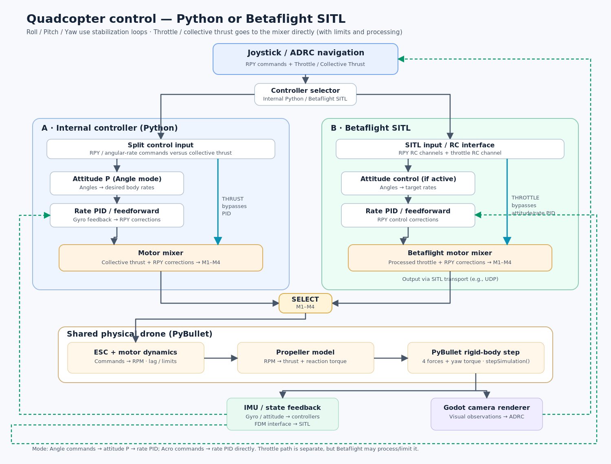

# 0003: Internal flight-control pipeline

Status: Completed (uncommitted)  
Implementation commit: Pending

## Goal and reference

Add the internal branch through an injectable Python API, preserving gravity and open-loop hover CLI runs.

The image describes the broader architecture; this milestone implements internal Angle/Acro stabilization and shared ideal physics components.

## Implementation steps

1. Add optional `control.backend: internal | betaflight`, default internal. Reject unknown settings; Betaflight raises UnsupportedControllerError before resource acquisition (CLI status 2).
2. Add immutable episode/step-scoped HighLevelCommand (Angle ZYX Euler radians or Acro body rates rad/s, collective newtons), HighLevelController reset/command/close, and small stabilization/feedback/model contracts.
3. Compose high-level source → ideal feedback → internal stabilization → existing mixer → RotorCommand. Angle uses shortest-path body quaternion error and attitude P; Acro bypasses it. Both use bounded rate PID and optional zero-default rate feedforward; thrust bypasses stabilization.
4. Implement reusable scalar PID: explicit dt, derivative on measurement with zero first derivative, bounded integral contribution and conditional integration at output saturation. Require explicit gains/rate/torque/integral limits; no flight tuning defaults.
5. Extract ideal motor dynamics (instantaneous target rad/s, zero on reset) and compose the existing thrust/reaction models in an ideal propeller model. Inject both into physics; apply offset thrust and yaw reaction once.
6. Add provider reset/close lifecycle, update hover provider, and preserve original failures while attempting all cleanup. Validate commands before controller updates/physics steps.
7. Update design/menu/entry-point/force-roadmap documentation and verify behavior.

## Interfaces and defaults

HighLevelController, stabilization, control-feedback, motor-dynamics and propeller contracts are project-owned and PyBullet-independent. Ground truth is read-only; world angular velocity converts to body rates. Sensor slots remain unchanged. Controller selection belongs to composition. New control is API-only, with no production high-level controller or gain YAML. Existing rotor/environment semantics remain intact.

Defer hover feedback control, joystick, ADRC, Godot, noisy sensors, real motor lag, battery behavior, and Betaflight integration. No dependency changes, commits or pushes are authorized.

## Verification

Baseline: 82 tests passed. Verify configuration/default/rejection before resources, PID P/I/D/dt/saturation/reset/invalid input, Angle/Acro routing/quaternion wrapping/frame conversion/feedforward/thrust bypass/identity, ideal model equations and no duplicate torques, injected-source stabilization integration, and failure/interruption/cleanup. Run `uv run pytest -q`, preserve gravity/hover/CLI/headless checks, and check the relative image link.

Outcome: `uv run pytest -q` passed **140 tests**. Locked headless gravity and open-loop hover CLI smoke checks completed 1200 steps each; hover ended at (0, 0, 1) m. Image SHA-256 matches the supplied original; relative image link resolves. `git diff --check` passed. No dependency changes or commits were made.
